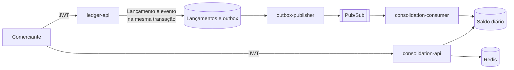

# Fluxo de caixa diário

Sistema para um comerciante controlar o fluxo de caixa: registra débitos e créditos e oferece o saldo diário consolidado. O serviço de lançamentos continua disponível quando o consolidado cai.

Este repositório é um exercício de arquitetura. O código prova as decisões centrais, e a [documentação](docs/README.md) mostra como elas foram tomadas.

## Como funciona



1. A `ledger-api` grava o lançamento e o evento na mesma transação, em uma outbox.
2. O `outbox-publisher` envia os eventos à mensageria. Se ela cair, os eventos esperam na outbox.
3. O `consolidation-consumer` aplica cada evento ao saldo do dia, uma única vez.
4. A `consolidation-api` responde o saldo sem chamar Lançamentos.

Os serviços não se chamam e não compartilham banco. Por isso, a queda do consolidado não afeta os lançamentos. O preço é o saldo ficar alguns segundos atrás, e a resposta informa até quando está atualizado, em `updatedThrough`.

## Resultados

Medidos localmente, com autenticação, rate limiting e telemetria ativos. Os detalhes estão nos [resultados de testes](docs/09-resultados-de-testes.md).

| Requisito | Meta | Resultado |
|---|---|---|
| Lançamentos disponível com o consolidado fora | Nenhuma escrita recusada | 0 falhas em 4.501 escritas |
| Vazão do consolidado | 50 req/s | 50 req/s por 5 minutos |
| Perda de requisições | No máximo 5% | 0%, com p95 de 7,55 ms |

## Executar

**Requisitos:** Docker com Compose, Bash, `curl`, `python3` e `uuidgen`. O .NET não precisa estar instalado. Reserve cerca de 4 GiB de memória para o Docker. Os testes de carga também precisam do [k6](https://k6.io).

```bash
docker compose up -d --build --wait
```

| Serviço | Endereço |
|---|---|
| API de Lançamentos | `http://localhost:18081` |
| API do Consolidado | `http://localhost:18082` |
| Keycloak | `http://localhost:18083` |
| Grafana | `http://localhost:18084` |
| Prometheus | `http://localhost:18085` |
| Tempo | `http://localhost:18086` |

## Usar a API

As APIs exigem um token. O comando abaixo cria um comerciante no Keycloak local e obtém o token dele:

```bash
. scripts/auth.sh
MERCHANT=$(uuidgen | tr '[:upper:]' '[:lower:]')
TOKEN=$(new_client "$MERCHANT")
TODAY=$(TZ=America/Sao_Paulo date +%F)
```

Registre um crédito:

```bash
curl -i -X POST http://localhost:18081/v1/entries \
  -H "Authorization: Bearer $TOKEN" \
  -H "Idempotency-Key: $(uuidgen)" \
  -H 'Content-Type: application/json' \
  -d "{\"entryType\":\"CREDIT\",\"amountCents\":35000,\"accountingDate\":\"$TODAY\",\"description\":\"Venda\"}"
```

Consulte o saldo do dia:

```bash
curl -s "http://localhost:18082/v1/balances/daily?date=$TODAY" -H "Authorization: Bearer $TOKEN"
```

| Rota | Escopo | Finalidade |
|---|---|---|
| `POST /v1/entries` | `entries.write` | Registra um lançamento |
| `GET /v1/entries?date=` | `entries.read` | Lista os lançamentos do dia |
| `GET /v1/entries/{id}` | `entries.read` | Consulta um lançamento |
| `POST /v1/entries/{id}/reversal` | `entries.write` | Estorna um lançamento |
| `GET /v1/balances/daily?date=` | `balances.read` | Saldo de um dia |
| `GET /v1/balances/period?start=&end=` | `balances.read` | Saldo por dia, em até 366 dias |

Os contratos completos estão em [docs/contratos](docs/contratos/README.md). Valores são inteiros em centavos, e o limite é de R$ 1 bilhão por lançamento.

## Testar

| Comando | O que faz | Tempo aproximado |
|---|---|---|
| `./scripts/test.sh` | Testes de unidade e de integração, em contêiner | 30 segundos |
| `./scripts/smoke.sh` | 14 verificações de ponta a ponta, com a stack no ar | 30 segundos |
| `./scripts/resilience.sh` | Derruba dependências durante a carga e prova que nada se perdeu | 3 minutos |
| `./scripts/load-test.sh` | Pico de 50 leituras por segundo, com e sem cache | 8 minutos |
| `./scripts/mutation.sh` | Testes de mutação do domínio | 2 minutos |

Rode `smoke.sh` em uma base recente. Depois de um teste de carga, a reconstrução pode passar do tempo que ele espera. Para recomeçar do zero:

```bash
docker compose down -v
docker compose up -d --build --wait
```

## Observar

O Grafana abre sem login e traz os dashboards "Visão de serviço" e "Fluxo de eventos". Os alertas ficam em `http://localhost:18085/alerts`. Os traços podem ser explorados no Grafana, pela fonte de dados Tempo.

## Estrutura

```text
services/ledger/          serviço de escrita
services/consolidation/   serviço de leitura e consumidor
docs/                     documentação de arquitetura
docs/adr/                 decisões, com radar de trade-offs
docs/contratos/           OpenAPI, AsyncAPI e esquema do evento
infra/                    Keycloak, coletor, Tempo, Prometheus e Grafana locais
load-tests/               cenários k6
scripts/                  testes, carga, resiliência, mutação e reconstrução
tools/                    geradores de radares, resumo de decisões e ROI
```

Em cada serviço, `*.Core` é o domínio, sem dependência de banco ou mensageria. As regras ficam em `.spec.md`, ao lado do código, com cenários em `.feature` e testes em `.test.cs`. O código está em inglês, e a documentação, em português.

## Documentação

| Para entender | Leia |
|---|---|
| O que foi decidido | [Resumo das decisões](docs/16-resumo-de-decisoes.md) |
| Por que foi decidido | [ADRs](docs/adr/README.md) |
| A arquitetura | [Arquitetura-alvo](docs/03-arquitetura-alvo.md) e [transição](docs/04-arquitetura-transicao.md) |
| Os requisitos | [Domínios](docs/01-dominios-e-capacidades.md) e [requisitos](docs/02-requisitos.md) |
| Custos e retorno | [Custos](docs/05-custos.md) e [ROI](docs/19-roi-e-custo-operacional.md) |
| Operação | [Observabilidade](docs/06-observabilidade.md), [operação](docs/12-operacao.md) e [recuperação de desastres](docs/17-recuperacao-de-desastres.md) |
| Segurança | [Segurança](docs/07-seguranca.md) e [vulnerabilidades](docs/18-vulnerabilidades.md) |
| Tudo | [Índice completo](docs/README.md) |

Para alterar o projeto, leia o [guia de contribuição](CONTRIBUTING.md).

## Uso de IA

O código e a documentação foram escritos com o Claude Code. O escopo, as decisões e a revisão são do autor. `CLAUDE.md` e `AGENTS.md` guardam as instruções usadas.

## O que não está pronto para produção

Tudo roda localmente, e nada foi implantado no GCP. A arquitetura-alvo é uma proposta.

- Cloud Run, Cloud SQL, Pub/Sub real, rede e infraestrutura como código não foram exercitados
- Failover, restauração e exercícios de recuperação nunca foram feitos
- A auditoria não tem armazenamento separado, e o limite de requisições vale por instância
- As vulnerabilidades em aberto estão no [registro](docs/18-vulnerabilidades.md), que não substitui um pentest
- Custos e ROI usam premissas, e não dados reais
