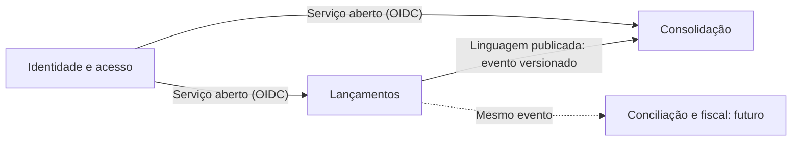

# Domínios funcionais e capacidades de negócio

## Cadeia de valor

## Domínios

| Domínio | Tipo | Por quê | Abordagem |
|---|---|---|---|
| Lançamentos | Principal | Guarda a verdade financeira do comerciante | Código próprio |
| Consolidação | Principal | Transforma movimentos em informação de decisão | Código próprio |
| Identidade e acesso | Genérico | Necessário, mas sem diferencial | Produto pronto, por OIDC |
| Observabilidade | Suporte | Sustenta a operação | Padrão aberto e serviços gerenciados |
| Mensageria | Suporte | Conecta os domínios | Serviço gerenciado |

## Mapa de capacidades

| Domínio | Capacidade | Descrição | Serviço |
|---|---|---|---|
| Lançamentos | Registrar lançamento | Aceita débitos e créditos válidos | Lançamentos |
| Lançamentos | Estornar lançamento | Anula um lançamento sem apagar o histórico | Lançamentos |
| Lançamentos | Consultar lançamentos | Localiza por identificador e por dia | Lançamentos |
| Lançamentos | Publicar fatos | Informa os demais contextos de forma confiável | Lançamentos |
| Consolidação | Agregar movimentos | Acumula créditos e débitos por dia | Consolidado |
| Consolidação | Informar saldo | Entrega saldo por dia e por período | Consolidado |
| Consolidação | Reconstruir consolidado | Refaz o saldo a partir dos lançamentos | Consolidado |
| Identidade e acesso | Autenticar e autorizar | Identifica o comerciante e limita o acesso | Provedor de identidade |

## Mapa de contextos

Lançamentos é o contexto fornecedor. Consolidação segue o contrato publicado em `docs/contratos/`, e um novo consumidor pode assinar o mesmo evento sem mudar Lançamentos.

## Eventos de domínio

| Comando | Agregado | Evento | Reação |
|---|---|---|---|
| Registrar lançamento | Lançamento | `entry.recorded` | Atualiza o agregado do dia |
| Estornar lançamento | Lançamento | `entry.recorded`, com `reversalOf` | Atualiza o agregado do dia, com a natureza inversa |

O estorno é um lançamento comum que aponta para o original. Por isso, o consumidor trata um único tipo de evento.

## Regras de negócio

| ID | Regra |
|---|---|
| RN-01 | O valor é um inteiro maior que zero, em centavos |
| RN-02 | O tipo é `CREDIT` ou `DEBIT` |
| RN-03 | A data de competência não pode estar no futuro |
| RN-04 | Lançamentos nunca são alterados nem excluídos |
| RN-05 | Um lançamento só pode ser estornado uma vez |
| RN-06 | Um estorno não pode ser estornado |
| RN-07 | O estorno tem a natureza inversa, o mesmo valor e a mesma data de competência do original |
| RN-08 | O comerciante só acessa os próprios dados |
