# Arquitetura-alvo

Os diagramas seguem o modelo C4. As decisões estão nos [ADRs](adr/README.md).

## C4 nível 1: contexto

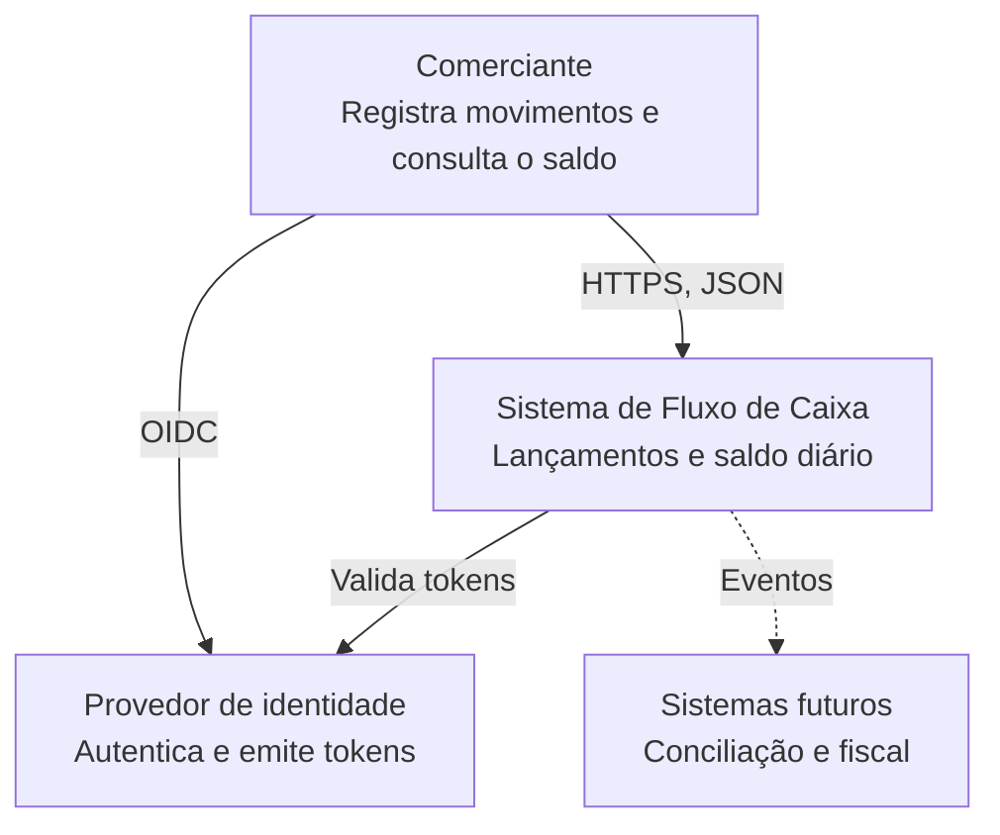

## C4 nível 2: contêineres

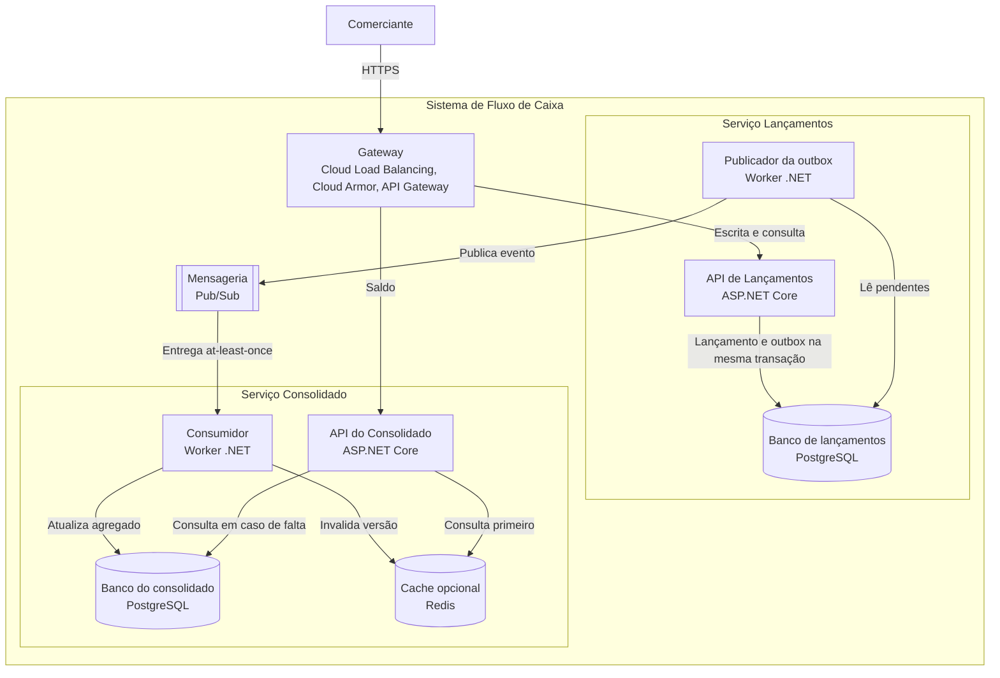

## C4 nível 3: componentes de Lançamentos

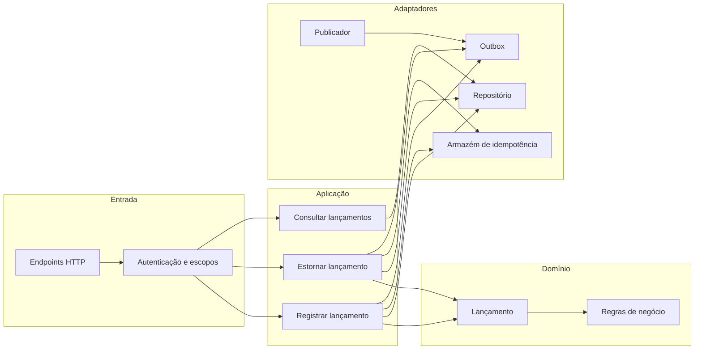

## C4 nível 3: componentes do Consolidado

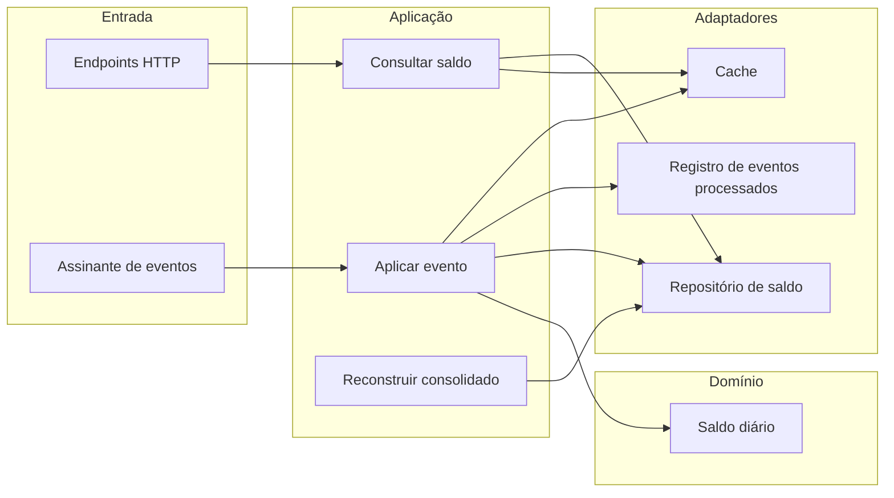

## C4 de implantação

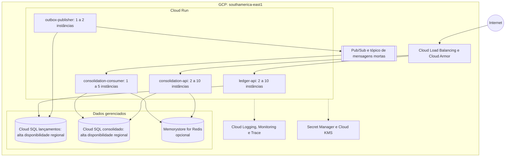

A rede está em [10-rede.md](10-rede.md).

## Sequências

### Registrar lançamento

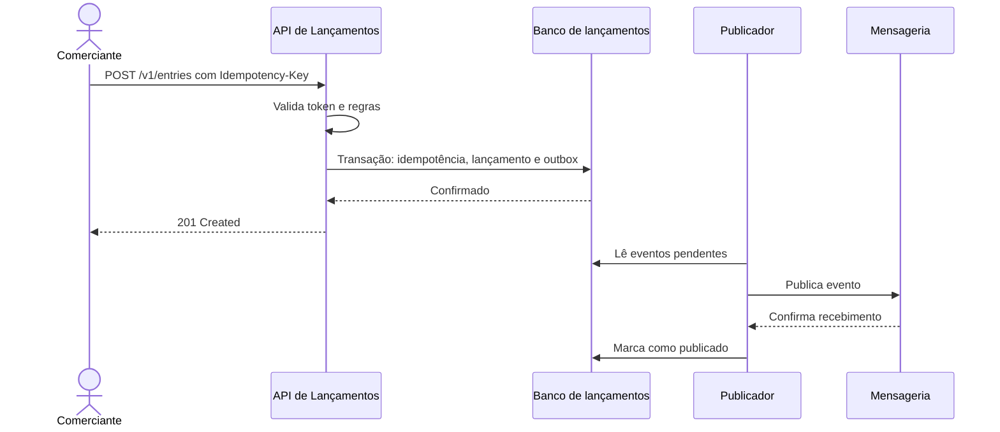

### Consolidar evento

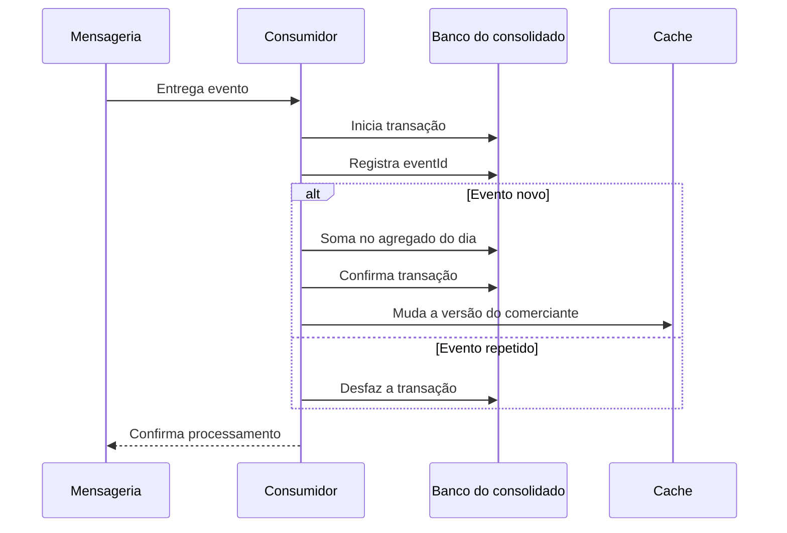

### Consultar saldo

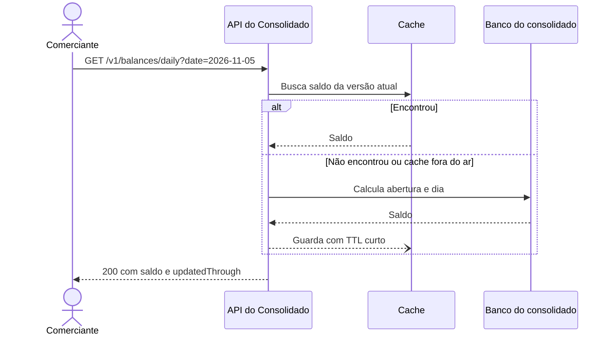

### Consolidado fora do ar

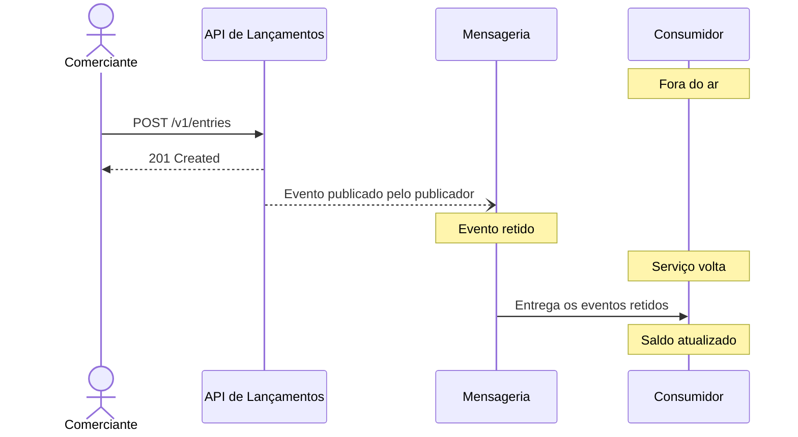

## Estados

### Lançamento

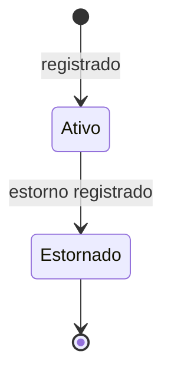

O estado é derivado. O registro original nunca muda, e "Estornado" significa que existe um lançamento com `reversal_of` apontando para ele.

### Evento na outbox

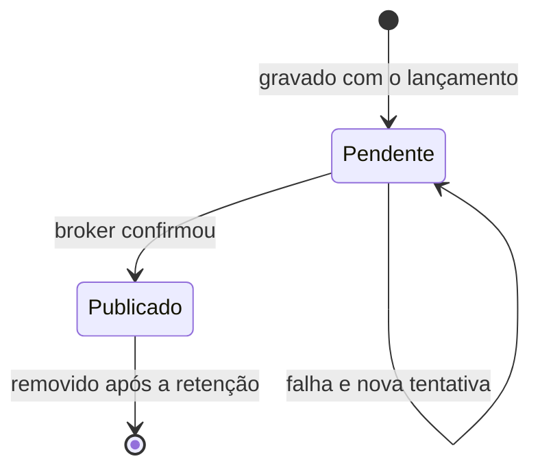

## Modelo de dados

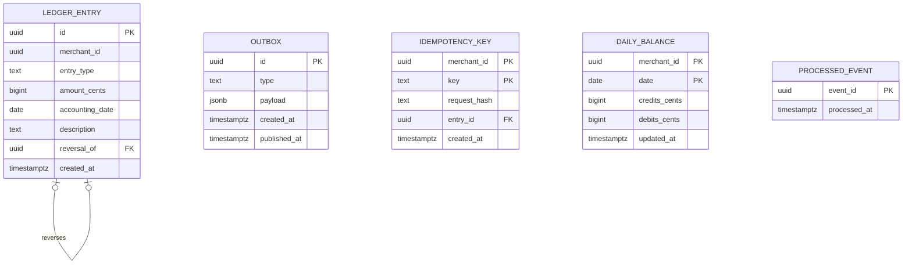

`LEDGER_ENTRY`, `OUTBOX` e `IDEMPOTENCY_KEY` ficam no banco de lançamentos. `DAILY_BALANCE` e `PROCESSED_EVENT` ficam no banco do consolidado. Um índice único em `reversal_of` garante RN-05 mesmo com requisições concorrentes.

## Tratamento de falhas

| Se falhar | Efeito | Recuperação |
|---|---|---|
| Consolidado | Lançamentos segue normal, e os eventos ficam retidos | O serviço volta e processa a fila |
| Mensageria | Lançamentos segue normal, e os eventos ficam na outbox | O publicador retoma o envio |
| Publicador | Lançamentos segue normal, e a outbox cresce | Nova instância retoma do pendente |
| Banco de lançamentos | Escrita indisponível, e o saldo calculado segue consultável | Failover do Cloud SQL |
| Banco do consolidado | Consultas sem cache falham, e os eventos ficam retidos | Failover e processamento da fila |
| Cache | A consulta vai ao banco, com latência maior | O cache se preenche com o uso |
| Evento inválido | Vai para o tópico de mensagens mortas após as retentativas | Alerta, correção e reenvio |
| Provedor de identidade | Novos tokens falham, e os válidos seguem aceitos até expirar | Failover do provedor |

## Impacto por área

| Área | Impacto |
|---|---|
| Dados | Duas bases independentes, retenção definida e reconstrução a partir dos lançamentos |
| Segurança | OIDC, escopos, TLS, criptografia em repouso, auditoria e WAF |
| Infraestrutura | Serviços gerenciados no GCP, rede privada e alta disponibilidade regional |
| Soluções | Contrato de evento aberto para novos consumidores, como conciliação |
| Software | Duas bases de código em C#, arquitetura hexagonal e testes automatizados |

## Riscos de arquitetura

| Risco | Mitigação |
|---|---|
| Defasagem do saldo gerar decisão errada | Informar `updatedThrough` e monitorar o atraso |
| Agregado divergir dos lançamentos | Reconstrução e reconciliação periódica. Como `eventId` é a identidade do lançamento, reenviar eventos não conta valores duas vezes |
| Outbox crescer sem controle | Alerta de idade do evento mais antigo e limpeza |
| Mensagens mortas ficarem sem tratamento | Alerta e runbook de reenvio |
| Fila acumulada esgotar as conexões do banco ao voltar de uma queda | Limite de 16 eventos em processamento e pool de conexões por processo. Encontrado no teste de resiliência |
| Evento publicado antes de existir assinatura ser descartado pelo Pub/Sub | Provisionar tópico e assinatura antes do publicador, como etapa própria |
