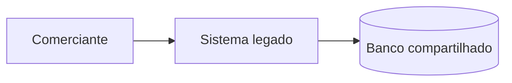
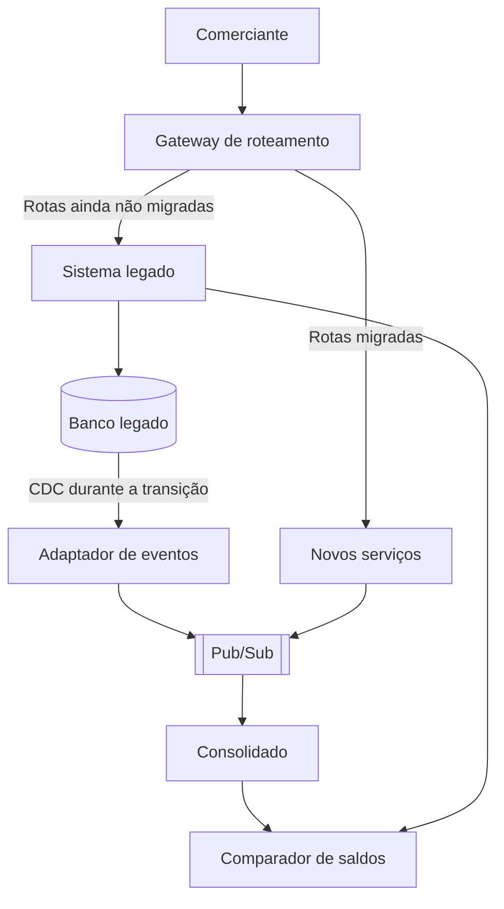

# Arquitetura de transição

O PDF não descreve um legado, então este documento assume um cenário: um sistema único, com banco compartilhado, onde o relatório de saldo é calculado por consultas diretas aos lançamentos. A estratégia está no [ADR-0010](adr/0010-estrategia-de-migracao.md).

## Situação de partida

Nesse cenário, um pico de relatórios disputa recursos com os lançamentos, que é o problema que o requisito de independência quer eliminar.

## Estado intermediário

## Fases

| Fase | O que muda | Critério para avançar | Plano de retorno |
|---|---|---|---|
| 0. Preparar | Gateway entra na frente do legado, sem mudar o roteamento | Latência e erros iguais aos de antes | Remover o gateway do caminho |
| 1. Espelhar | CDC alimenta o novo consolidado, que ainda não atende ninguém | Saldos iguais aos do legado por 30 dias | Desligar o CDC |
| 2. Migrar leituras | Consultas de saldo vão para o consolidado, por grupos de comerciantes | Sem divergência e SLO cumprido por 2 semanas | Voltar a rota do grupo ao legado |
| 3. Migrar escritas | Lançamentos dos comerciantes migrados vão para o novo serviço | Reconciliação diária sem diferença | Voltar o grupo ao legado e reenviar os lançamentos novos |
| 4. Desligar | Legado fica somente leitura e depois é desligado | Todos os comerciantes migrados e prazo de retenção cumprido | Reabrir o legado enquanto a retenção durar |

## Riscos da transição

| Risco | Mitigação |
|---|---|
| Saldo divergente entre os sistemas | Comparador automático, com bloqueio de avanço |
| Lançamento duplicado na mudança de escrita | Cada comerciante escreve em um único sistema por vez |
| Histórico incompleto no novo serviço | Carga inicial conferida por contagem e soma por comerciante |
| Transição longa demais | Prazo por fase e critério de saída definido antes do início |

## O que este repositório prova

O consolidado aceita eventos de qualquer origem que siga o contrato, e a reconstrução mostra que o saldo pode ser refeito por reenvio. O gateway, o CDC e o comparador são apenas propostas.
