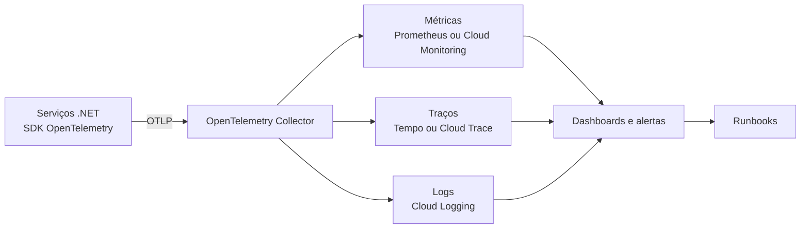
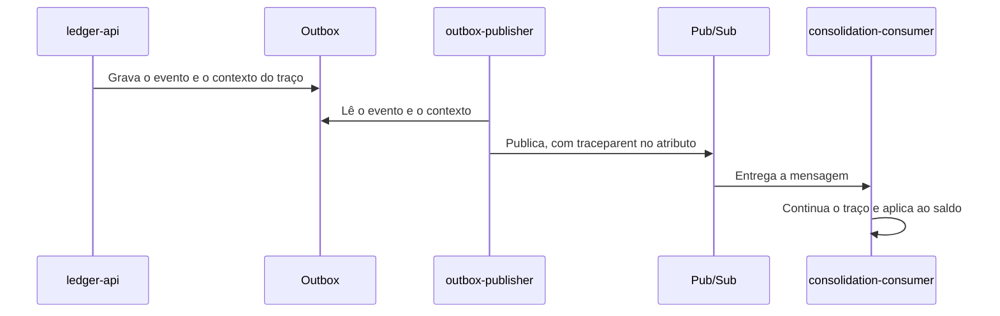

# Monitoramento e observabilidade

O sistema é assíncrono, então uma falha pode aparecer longe da requisição que a causou. A observabilidade precisa responder a estas perguntas sem acesso ao servidor:

| Pergunta | Quem pergunta | Sinal que responde |
|---|---|---|
| O comerciante consegue registrar um lançamento? | Operação | SLI de disponibilidade da escrita |
| O saldo está correto e atualizado? | Comerciante e operação | Defasagem e reconciliação |
| Onde este lançamento parou? | Suporte | Traço, com `entryId` |
| Algum valor ficou fora do saldo? | Operação | Mensagens mortas e idade da outbox |
| Vamos cumprir o SLO deste mês? | Líder técnico | Orçamento de erro |
| Quando o sistema vai saturar? | SRE | Conexões, CPU e profundidade das filas |

A instrumentação usa OpenTelemetry, conforme o [ADR-0009](adr/0009-observabilidade.md).

## Situação atual

| Item | Situação |
|---|---|
| Verificações `/health/live` e `/health/ready` nas APIs | Implementado |
| Logs de erro do publicador e do consumidor | Implementado, em texto simples |
| Métricas, traços, logs estruturados, dashboards e alertas | Desenho deste documento, a implementar no M6 |
| Exportação para o Google Cloud Observability | Proposta, sem deploy |

## Fluxo da telemetria

**A telemetria nunca impede uma escrita.** A exportação é assíncrona, com fila limitada, e descarta dados se o coletor cair. Perder telemetria é aceitável, e perder um lançamento não é. Isso aplica o princípio P1.

## SLOs

| SLI | SLO proposto | Janela | Orçamento de erro |
|---|---|---|---|
| Disponibilidade de `POST /v1/entries` | 99,9% | 30 dias | Cerca de 43 minutos |
| Latência de escrita p95 | Até 300 ms | 30 dias | 5% das requisições |
| Sucesso de consultas de saldo | 99,5% | 30 dias | 0,5% das requisições. O PDF tolera 5% no pico |
| Latência de leitura p95 | Até 200 ms | 30 dias | 5% das requisições |
| Defasagem do saldo p95 | Até 5 s | 30 dias | 5% dos eventos |

Se o orçamento de erro acabar, mudanças de funcionalidade param até a confiabilidade voltar à meta.

### Como cada SLI é calculado

| SLI | Eventos bons | Eventos válidos | Fica de fora |
|---|---|---|---|
| Disponibilidade da escrita | Respostas abaixo de 500 | Todas as requisições de `POST /v1/entries` | Verificações de saúde |
| Latência de escrita | Respostas em até 300 ms | Respostas abaixo de 500 | Erros, que já contam na disponibilidade |
| Sucesso de consultas | Respostas abaixo de 500 | Todas as requisições de `/v1/balances` | Verificações de saúde |
| Latência de leitura | Respostas em até 200 ms | Respostas abaixo de 500 | Erros |
| Defasagem | Eventos aplicados em até 5 s | Eventos aplicados | Reenvios de uma reconstrução |

Respostas 4xx contam como boas, porque indicam erro do cliente, e não do sistema. Um aumento de 401 ou de 429 tem alerta próprio.

## Métricas

As métricas HTTP seguem as convenções do OpenTelemetry. As demais são próprias do sistema.

| Métrica | Tipo | Atributos | Origem | Por quê |
|---|---|---|---|---|
| `http.server.request.duration` | Histograma | Rota, método e status | APIs | Taxa, erros e latência |
| `outbox.pending.events` | Medidor | Nenhum | Publicador | Mostra fila acumulada |
| `outbox.oldest.age` | Medidor, em segundos | Nenhum | Publicador | Mostra falha no publicador ou na mensageria |
| `outbox.published.events` | Contador | Resultado | Publicador | Mostra a vazão do envio |
| `consumer.processed.events` | Contador | Resultado: aplicado, repetido ou erro | Consumidor | Mostra repetição e falha |
| `balance.lag` | Histograma, em segundos | Nenhum | Consumidor | Tempo entre `occurredAt` e a aplicação ao saldo |
| `cache.requests` | Contador | Resultado: acerto, erro ou desconectado | API de saldo | Mostra degradação silenciosa |
| `reconciliation.difference.cents` | Medidor | Nenhum | Reconciliação, proposta | Detecta divergência |

| Sinal externo | Origem | Por quê |
|---|---|---|
| Mensagens não confirmadas e idade da mais antiga | Pub/Sub | Mostra consumidor parado ou lento |
| Mensagens no tópico de mensagens mortas | Pub/Sub | Toda mensagem ali é um valor fora do saldo |
| Conexões, CPU, disco e replicação | Cloud SQL | O teste de resiliência mostrou o risco de esgotar conexões |
| Instâncias, CPU e memória | Cloud Run | Mostra saturação |

**Cardinalidade:** `merchantId`, `entryId` e `traceId` nunca são atributos de métrica. Cada valor novo cria uma série, e isso eleva o custo sem limite. Esses identificadores ficam em logs e traços. Por isso, as métricas não mostram um problema de um único comerciante: a investigação parte dos logs.

## Rastreamento

Um lançamento deve ser seguido da requisição até o saldo, mesmo com a outbox no meio do caminho:

O contexto usa o padrão W3C Trace Context. Como a publicação acontece depois do fim da requisição, a `outbox` precisa guardar esse contexto em uma nova coluna, `trace_context`. Sem isso, o traço termina na transação da escrita.

| Span | Processo | Atributos |
|---|---|---|
| `POST /v1/entries` | `ledger-api` | Rota e status |
| `outbox publish` | `outbox-publisher` | `eventId` |
| `entry.recorded process` | `consolidation-consumer` | `eventId` e resultado |
| Comandos SQL | Todos | Só o tipo da operação, sem parâmetros |

**Amostragem:** 100% no ambiente local e 10% na nuvem, decidida no início do traço e mantida até o fim. Erros devem ser preservados quando o coletor permitir amostragem na cauda. Esse valor é uma estimativa, compatível com os spans previstos nos [custos](05-custos.md). O perfil real de uso pode pedir outro valor.

## Logs

Os logs são JSON na saída padrão, sem arquivo local.

| Campo | Conteúdo |
|---|---|
| `timestamp` | UTC |
| `severity` | `Information`, `Warning` ou `Error` |
| `service` | Nome do processo |
| `traceId` e `spanId` | Ligação com o traço |
| `merchantId` | Comerciante da operação |
| `entryId` e `eventId` | Quando houver |
| `message` | Texto fixo, com campos separados |

| Nível | Quando usar |
|---|---|
| `Error` | Falha que precisa de ação, como evento que não foi aplicado |
| `Warning` | Degradação tolerada, como cache desconectado |
| `Information` | Início, parada e operações de manutenção |

Requisições bem-sucedidas não geram log. As métricas e os traços já as cobrem, e isso controla o custo.

**Nunca registrar:** descrição do lançamento, token, cabeçalho `Authorization`, senha ou corpo de requisição. Um teste automatizado deve garantir isso no M6.

**Trilha de auditoria:** escritas, estornos, acessos negados e operações de manutenção, como `--reset` e `--republish`, precisam de um registro separado, com cliente, operação e resultado. A retenção dessa trilha é definida pela conformidade.

## Verificações de saúde

| Rota | Pergunta | O que verifica | Uso |
|---|---|---|---|
| `/health/live` | O processo está vivo? | Só o processo | Reiniciar a instância |
| `/health/ready` | Pode receber tráfego? | Conexão com o próprio banco | Retirar a instância do tráfego |

As verificações não incluem o consolidado, a mensageria nem o cache. Se incluíssem, a queda de uma dependência opcional tiraria Lançamentos do ar, contrariando o princípio P1.

## Dashboards

| Dashboard | Público | Conteúdo |
|---|---|---|
| Visão de serviço | Todos | SLOs, orçamento restante e estado dos alertas |
| Fluxo de eventos | Operação | Outbox, publicação, fila, mensagens mortas e defasagem |
| APIs | Equipe técnica | Taxa, erros e latência por rota |
| Capacidade | SRE | Conexões, CPU, instâncias e profundidade das filas |
| Segurança | Segurança da informação | Taxa de 401, 403 e 429 |

## Alertas

Cada alerta precisa exigir uma ação. Se não houver ação, ele vira informação de dashboard.

| Alerta | Condição | Severidade | Ação |
|---|---|---|---|
| Escritas falhando | Erro 5xx acima de 1% por 5 minutos | Crítica | [Banco indisponível](12-operacao.md#banco-indisponível) |
| Consumo rápido do orçamento | Queima 14 vezes acima do normal, em 1 hora e em 5 minutos | Crítica | Investigar e congelar mudanças |
| Consumo lento do orçamento | Queima 6 vezes acima do normal, em 6 horas e em 30 minutos | Alta | Abrir investigação |
| Outbox parada | Evento pendente há mais de 2 minutos | Alta | [Outbox parada](12-operacao.md#outbox-parada) |
| Consumidor atrasado | Mensagem mais antiga há mais de 2 minutos | Alta | [Consumidor atrasado](12-operacao.md#consumidor-atrasado) |
| Mensagens mortas | Qualquer mensagem no tópico | Alta | [Mensagens mortas](12-operacao.md#mensagens-mortas) |
| Saldo divergente | Diferença na reconciliação, quando existir | Crítica | [Saldo divergente](12-operacao.md#saldo-divergente) |
| Acessos negados em alta | 401 e 403 acima do normal por 10 minutos | Média | Avaliar com segurança |
| Conexões do banco | Uso acima de 80% por 5 minutos | Média | Revisar pools e instâncias |
| Cache fora | Sem conexão por 5 minutos | Baixa | Verificar o Redis. A API segue pelo banco |
| Telemetria ausente | Sem dados de um processo por 5 minutos | Alta | Verificar o coletor. Sem dados não significa sem problema |

| Severidade | Quem recebe | Resposta esperada |
|---|---|---|
| Crítica | Plantão, com chamada | Imediata |
| Alta | Plantão, por mensagem | Em até 30 minutos |
| Média | Canal da equipe | No mesmo dia útil |
| Baixa | Canal da equipe | Quando possível |

A janela dupla evita que um alerta continue ativo depois que o problema passou. A janela longa confirma o impacto, e a curta confirma que ele ainda existe.

## Ferramentas

| Função | Local | GCP |
|---|---|---|
| Coleta | OpenTelemetry Collector | OpenTelemetry Collector |
| Métricas | Prometheus | Cloud Monitoring |
| Traços | Tempo ou Jaeger | Cloud Trace |
| Logs | Saída do contêiner | Cloud Logging |
| Dashboards | Grafana | Cloud Monitoring |

## Retenção

| Dado | Retenção proposta | Motivo |
|---|---|---|
| Métricas | 6 semanas | Cobre a janela do SLO e permite comparar meses |
| Traços | 30 dias | Investigação de incidentes |
| Logs operacionais | 30 dias | Investigação de incidentes |
| Trilha de auditoria | Definida pela conformidade | Pode ser exigida por anos, com armazenamento separado |

Esses prazos são propostas iniciais. Os custos previstos para telemetria estão nos [custos](05-custos.md).

## Como validar

| Validação | Quando |
|---|---|
| Um lançamento forma um único traço, da API até o saldo | M6 |
| `resilience.sh` dispara os alertas de outbox e de consumidor | M6 |
| A queda do coletor não afeta a escrita | M6 |
| Logs não contêm dados proibidos | M6 |
| Carga repetida com a telemetria ativa, para medir o custo dela | M6 |

## Capacidade

Medições locais estão nos [resultados de testes](09-resultados-de-testes.md). Com 50 leituras e 10 escritas por segundo, o p95 ficou abaixo de 12 ms, com folga sobre as metas.

O limite mais provável são as conexões do banco, então cada processo precisa de um pool definido:

| Processo | Instâncias máximas | Pool por instância | Conexões |
|---|---:|---:|---:|
| `ledger-api` | 10 | 10 | 100 |
| `outbox-publisher` | 2 | 5 | 10 |
| **Banco de lançamentos** | | | **110** |
| `consolidation-api` | 10 | 10 | 100 |
| `consolidation-consumer` | 5 | 16 | 80 |
| **Banco do consolidado** | | | **180** |

A soma precisa ficar abaixo de `max_connections`, com margem para manutenção. Se o número de instâncias crescer, a alternativa é um pooler de conexões.
