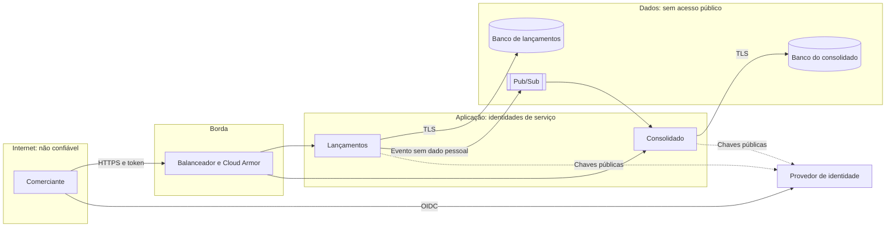

# Segurança

A autenticação segue o [ADR-0008](adr/0008-autenticacao-e-autorizacao.md). A coluna "Situação" separa o que já existe do que entra no M6 ou fica como proposta para o GCP.

## Fronteiras de confiança e fluxo de dados

## Classificação de dados

| Dado | Classe | Exposição | Cuidado |
|---|---|---|---|
| Valor, tipo e data | Confidencial | APIs e eventos | Acesso restrito ao comerciante |
| `merchantId` | Interno | APIs, eventos e logs | Identificador opaco, sem CNPJ ou nome |
| Descrição | Confidencial e possivelmente pessoal | Só na API de lançamentos | Fora dos eventos e dos logs |
| Tokens | Secreto | Cabeçalho da requisição | Nunca registrados |
| Credenciais | Secreto | Secret Manager | Fora do repositório |

## Modelo de ameaças STRIDE

| Ameaça | Exemplo | Controle | Situação |
|---|---|---|---|
| Falsificação | Cliente se passa por outro comerciante | Token assinado, com `merchantId` vindo do token | M6. Hoje há cabeçalho provisório |
| Falsificação | Sistema publica evento falso | Permissão de publicação apenas para `outbox-publisher` | Proposta no GCP |
| Adulteração | Alteração de um lançamento | Lançamento imutável, sem rota de edição | Implementado |
| Adulteração | Manipulação do valor em trânsito | TLS em todas as conexões | Proposta no GCP |
| Repúdio | Comerciante nega um lançamento | Registro imutável e auditoria com identidade | Parcial. Auditoria completa é proposta |
| Divulgação | Acesso a dados de outro comerciante | Toda consulta filtra pelo comerciante, com resposta 404 | Implementado |
| Divulgação | Vazamento por logs | Logs sem descrição nem token | M6 |
| Divulgação | Banco exposto | Sem IP público e com criptografia em repouso | Proposta no GCP |
| Negação de serviço | Excesso de requisições | Rate limiting e Cloud Armor | M6 e proposta no GCP |
| Negação de serviço | Fila cheia derruba o banco | Limite de eventos em processamento e pools | Implementado e testado |
| Elevação de privilégio | Token de leitura faz escrita | Escopos por operação | M6 |
| Elevação de privilégio | Serviço acessa o banco de outro | Identidade por serviço e bancos separados | Proposta no GCP |

## Critérios de segurança para integração

Qualquer consumidor das APIs ou dos eventos precisa cumprir estas regras:

| Critério | Regra |
|---|---|
| Autenticação | OAuth2 client credentials, com tokens de até 15 minutos |
| Autorização | Escopo mínimo: `entries.read`, `entries.write` ou `balances.read` |
| Transporte | TLS 1.2 ou superior |
| Idempotência | `Idempotency-Key` obrigatória em toda escrita |
| Limites | Rate limit por cliente, com resposta 429 |
| Eventos | Uma assinatura e uma identidade por consumidor, com permissão só de leitura |
| Contrato | Consumidor ignora campos desconhecidos e aceita repetição e ordem diferente |
| Dados | Só recebe o mínimo necessário. Eventos não levam a descrição |
| Segredos | Em cofre, com rotação periódica |
| Auditoria | Todo acesso registra cliente, operação e resultado |
| Integrações críticas | mTLS e tokens vinculados ao certificado, seguindo perfis como FAPI |

## Pontos de atenção regulatórios

Estes pontos precisam de validação da área de conformidade do cliente:

- **Nuvem em instituição financeira:** a Resolução CMN 4.893 trata de política de segurança cibernética e de contratação de processamento e nuvem. A contratação pode exigir comunicação ao regulador e previsão de acesso a dados e continuidade.
- **LGPD:** quando o comerciante for pessoa física, parte dos dados é pessoal. Isso exige base legal, retenção definida e atendimento a pedidos do titular. Como o lançamento é imutável, a exclusão precisa ser tratada por anonimização da descrição.
- **Retenção:** o prazo dos registros financeiros precisa ser definido antes da produção.
- **Localização:** os dados ficam em `southamerica-east1`. Uma réplica em outro país, como Santiago, exige avaliação específica.
