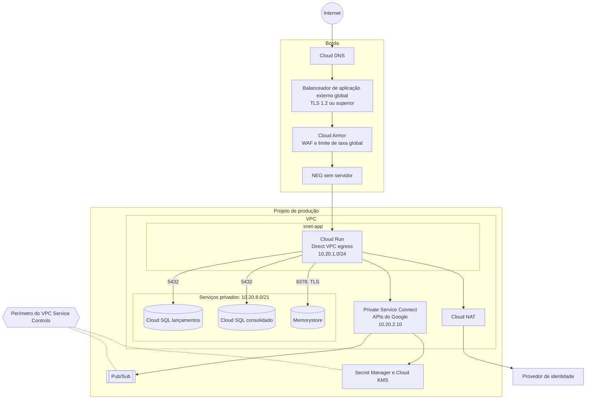

# Rede no GCP

Esta topologia é uma proposta para o ambiente de produção. Os endereços são exemplos e devem seguir o plano de endereçamento do cliente.

## Topologia

## Segmentos

| Segmento | Faixa de exemplo | Conteúdo | Exposição |
|---|---|---|---|
| Borda | Gerenciada | Balanceador de aplicação externo global, Cloud Armor e NEG sem servidor | Pública, apenas 443 |
| `snet-app` | `10.20.1.0/24` | Saída dos serviços Cloud Run | Privada |
| Acesso a serviços privados | `10.20.8.0/21` | Cloud SQL e Memorystore | Privada, sem IP público |
| Private Service Connect | `10.20.2.10/32` | Acesso às APIs do Google | Privada |

## Regras de tráfego

| Origem | Destino | Porta | Finalidade |
|---|---|---|---|
| Internet | Balanceador | 443 | Entrada das APIs |
| Balanceador | Cloud Run, por NEG sem servidor | Gerenciada | Depois do Cloud Armor, que aplica o WAF e o limite de taxa global. O balanceador remove o `traceparent` enviado pelo cliente. A entrada `internal-and-cloud-load-balancing` só aceita tráfego vindo do balanceador, e cada serviço valida o token |
| Identidade de `ledger-api` e `outbox-publisher` | Cloud SQL lançamentos | 5432 | Dados de lançamentos |
| Identidade de `consolidation-api` e `consolidation-consumer` | Cloud SQL consolidado | 5432 | Dados de saldo |
| APIs e `consolidation-consumer` | Memorystore | 6378 | Cache opcional, com TLS |
| Serviços | Private Service Connect | 443 | Pub/Sub, Secret Manager, KMS e telemetria |
| Serviços | Provedor de identidade, via Cloud NAT | 443 | Chaves públicas dos tokens |
| Qualquer outro fluxo | Qualquer destino | Todas | Negado por padrão |

## Controles

- Sem IP público em bancos e cache
- Serviços Cloud Run sem acesso direto pela internet
- Sem API Gateway na borda: ele chama o Cloud Run pela URL pública `run.app`, e não pelo balanceador, então não alcançaria serviços com entrada restrita ao balanceador. Cada serviço já valida o JWT e os escopos, conforme o [ADR-0008](adr/0008-autenticacao-e-autorizacao.md). A decisão é a D-159 do [registro de decisões](15-registro-de-decisoes.md)
- Uma identidade de serviço por componente, com privilégio mínimo
- Cloud SQL acessado com identidade do IAM, sem senha fixa
- VPC Service Controls para reduzir o risco de saída de dados
- Registros de fluxo da VPC e do Cloud Armor enviados ao Cloud Logging
- Ambientes em projetos separados

## Conectividade com o cliente

Se sistemas internos precisarem acessar a solução, a conexão usa Cloud Interconnect ou Cloud VPN com o ambiente corporativo. Essa integração depende do desenho de rede do cliente e fica fora desta proposta.
