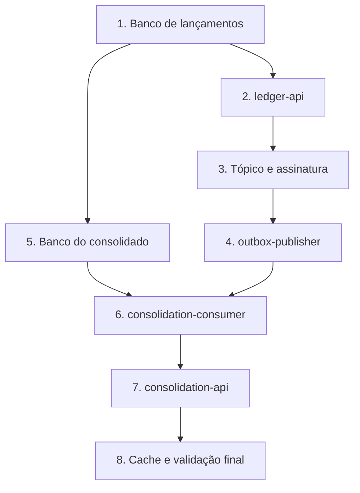

# Plano de recuperação de desastres

Este plano diz o que proteger, quando acioná-lo, em que ordem recuperar e como provar que a recuperação funcionou.

**Situação:** proposta. Nada foi implantado no GCP, então só a reconstrução do consolidado e as quedas de componentes foram testadas, e apenas no ambiente local. A seção [O que foi provado](#o-que-foi-provado) separa o medido do proposto.

## O que proteger

| Ativo | Criticidade | Efeito da perda | Proteção |
|---|---|---|---|
| Banco de lançamentos | Crítica | Perda de fatos financeiros, sem outra fonte | HA regional, backup, recuperação a um ponto no tempo e réplica |
| Outbox | Crítica | Evento pendente some, e o saldo fica incompleto | Mesmo banco e mesma proteção dos lançamentos |
| Banco do consolidado | Alta | Saldo indisponível, mas recuperável | HA regional, backup e reconstrução |
| Mensageria | Média | Atraso no saldo, sem perda: a outbox retém os eventos | Serviço gerenciado e reenvio |
| Cache | Baixa | Latência maior | Nenhuma: o dado é descartável |
| Segredos e configuração | Alta | Serviços não sobem | Secret Manager e controle de versão |
| Imagens dos serviços | Alta | Não é possível implantar | Artifact Registry e novo build a partir do Git |

## Objetivos por cenário

| Cenário | Estratégia | RTO proposto | RPO proposto |
|---|---|---:|---:|
| Falha de uma instância | Cloud Run recria a instância | Segundos | 0 |
| Falha de uma zona | Cloud SQL regional faz failover, e Cloud Run segue em outras zonas | Minutos | 0 |
| Mensageria indisponível | A outbox retém os eventos, e o publicador retoma | Depende do provedor | 0 |
| Erro humano no banco | Recuperação a um ponto no tempo, em uma cópia | 1 hora | 5 minutos |
| Perda do consolidado | Reconstrução a partir dos lançamentos | Ver a [capacidade medida](#o-que-foi-provado) | 0 |
| Perda da região | Réplica entre regiões promovida, com serviços implantados na região secundária | 1 hora | 5 minutos |
| Comprometimento de segurança | Isolar, trocar credenciais e restaurar de um ponto confiável | Definido no incidente | Definido no incidente |

**Exceção à perda zero:** a meta RNF-04 vale em operação normal e em falha de zona. Nos cenários de erro humano e de perda da região, até 5 minutos de lançamentos confirmados podem se perder, porque a réplica entre regiões é assíncrona. Evitar isso exigiria replicação síncrona entre regiões, com latência maior em toda escrita. A escolha é aceitar esse risco raro e tratá-lo com comunicação e reconciliação.

## Backups

| Item | Frequência | Retenção | Observação |
|---|---|---|---|
| Lançamentos | Backup diário e logs de transação contínuos | Definida pela conformidade | Base da recuperação a um ponto no tempo |
| Consolidado | Backup diário | Curta, a definir | Acelera a volta, mas os lançamentos são a fonte |
| Cópia isolada dos lançamentos | Diária | Definida pela conformidade | Em outro projeto, para resistir a credenciais comprometidas. Proposta |

## Papéis

| Papel | Quem | Responsabilidade |
|---|---|---|
| Comandante do incidente | SRE de plantão | Coordena e decide os próximos passos |
| Executor técnico | SRE e DBA | Executa os procedimentos |
| Decisor de negócio | Patrocinador do negócio | Autoriza a perda da região e a comunicação externa |
| Comunicação | Dono do produto | Informa comerciantes e áreas internas |
| Conformidade e segurança | Conformidade e Segurança da informação | Avaliam dados, notificações e réplica fora do país |

## Quando acionar

| Condição | Ação |
|---|---|
| Escrita indisponível por mais de 15 minutos, sem failover em andamento | Comandante avalia o acionamento |
| Perda ou alteração indevida de dados | Acionar imediatamente |
| Região indisponível sem previsão de volta dentro do RTO | Decisor de negócio autoriza o failover |
| Suspeita de invasão | Acionar com Segurança da informação, antes de restaurar |

Promover a réplica é difícil de desfazer, porque cria dois históricos possíveis. Por isso, a decisão é de uma pessoa nomeada, e não automática.

## Ordem de recuperação

A escrita volta primeiro, conforme o princípio P1. A assinatura precisa existir antes do publicador, porque a mensageria descarta o que chega a um tópico sem assinatura.

## Procedimentos

### Falha de zona

1. Confirme que o failover do Cloud SQL terminou.
2. Confira a taxa de erros e o tempo de resposta.
3. Clientes repetem as chamadas com a mesma `Idempotency-Key`, sem duplicar lançamentos.

### Erro humano no banco de lançamentos

1. Pare o `outbox-publisher`, para não espalhar o erro.
2. Restaure uma cópia do banco no ponto anterior ao erro, sem substituir o original.
3. Compare a cópia com o banco em uso e identifique o que foi perdido ou alterado.
4. Devolva ao banco em uso só as linhas afetadas. Isso preserva os lançamentos feitos depois do erro.
5. Substitua o banco inteiro só se a correção pontual não for possível. Nesse caso, os lançamentos posteriores ao ponto escolhido se perdem.
6. Religue o publicador.
7. Reconstrua o consolidado, porque ele pode estar à frente do banco restaurado.

### Perda do consolidado

1. Coloque a leitura de saldo em manutenção, porque a API responde saldo parcial durante a reconstrução.
2. Execute a reconstrução. Localmente, use `./scripts/rebuild-consolidation.sh`.
3. Acompanhe a fila até esvaziar.
4. Valide o saldo e libere a leitura.

Lançamentos seguem funcionando durante todo o processo.

### Perda da região

1. O decisor de negócio autoriza o failover.
2. Promova a réplica dos lançamentos na região secundária.
3. Implante os serviços e a rede na região secundária.
4. Crie tópico e assinatura antes de ligar o publicador.
5. Siga a [ordem de recuperação](#ordem-de-recuperação).
6. Reconstrua o consolidado.
7. Aponte o balanceador para a nova região.
8. Identifique a janela de perda e comunique os comerciantes afetados.

### Comprometimento de segurança

1. Preserve evidências antes de restaurar.
2. Isole os serviços afetados e revogue credenciais.
3. Escolha um ponto de restauração anterior ao comprometimento.
4. Restaure a partir da cópia isolada.
5. Avalie as notificações obrigatórias com Conformidade.

## Validar a recuperação

Recuperar só termina depois destas verificações:

| Verificação | Critério |
|---|---|
| Escrita | Um lançamento de teste é aceito e chega ao saldo |
| Integridade | Soma dos lançamentos igual à soma do consolidado |
| Fila | Outbox sem atraso e nenhuma mensagem morta sem análise |
| Duplicidade | Repetir uma `Idempotency-Key` não cria lançamento |
| Observabilidade | Telemetria e alertas de volta |
| Janela de perda | Lançamentos entre o ponto restaurado e o incidente identificados |

## Retorno à região original

1. Espere a estabilidade da região original.
2. Recrie o banco a partir da região em uso, sem reaproveitar o antigo.
3. Escolha uma janela de baixo uso.
4. Bloqueie a escrita, confirme a réplica em dia e troque o tráfego.
5. Repita as validações.

## Comunicação

| Momento | Público | Conteúdo |
|---|---|---|
| Acionamento | Áreas internas | Impacto, comandante e próxima atualização |
| Durante | Comerciantes | O que funciona, o que não funciona e previsão |
| Saldo em recuperação | Comerciantes | Saldo indisponível ou incompleto até a validação |
| Encerramento | Todos | Horário de volta e janela de perda, se houver |
| Depois | Equipe e gestão | Análise sem culpados, em até 5 dias úteis |

## Exercícios

O plano só vale se for testado.

| Exercício | Frequência | Meta |
|---|---|---|
| Restaurar backup em uma cópia | Trimestral | Medir o tempo real da recuperação |
| Reconstruir o consolidado | Trimestral | Medir a vazão com o volume de produção |
| Failover de zona | Semestral | Confirmar a volta sem perda |
| Simulação de perda da região | Anual | Testar decisões, comunicação e procedimentos |

## O que foi provado

| Cenário | Situação | Resultado |
|---|---|---|
| Consolidado fora do ar | Testado localmente | Lançamentos seguiu sem falhas, com a outbox retendo os eventos |
| Mensageria parada | Testado localmente | Nenhum evento perdido |
| Cache fora do ar | Testado localmente | Nenhuma falha de leitura |
| Reconstrução completa | Medido localmente | 8.809 lançamentos em 126 s, cerca de 74 por segundo, com saldo igual ao dos lançamentos |
| Failover, restauração e perda da região | Não testado | Depende de um ambiente no GCP |

A medição da reconstrução mudou duas conclusões:

- **O RTO de 1 hora não vale para qualquer tamanho.** A 74 eventos por segundo, uma hora cobre cerca de 266 mil lançamentos, e 1 milhão levaria quase 4 horas. A medição usou um consumidor em uma máquina local, e mais instâncias devem aumentar a vazão, o que ainda precisa ser medido no GCP.
- **Reconstruir não é invisível para o comerciante.** Durante a medição, a API respondeu 200 com saldo 0 e depois com saldo parcial. Hoje, só um procedimento manual evita isso. Ver a [V-08](18-vulnerabilidades.md).

## Lacunas conhecidas

| Lacuna | Efeito | Próximo passo |
|---|---|---|
| Não há infraestrutura como código | O RTO de 1 hora para a região é improvável sem ela | Terraform antes de produção |
| Sem região secundária aprovada | Perda da região sem recuperação | Avaliação de conformidade |
| Reconstrução só completa | Recuperar demora mais conforme a base cresce | Reenvio a partir de uma data e por comerciante |
| Sem modo de manutenção no saldo | Comerciante pode ver saldo parcial | Implementar a V-08 |
| Reconciliação automática ausente | Divergência demora a aparecer | Implementar antes de produção |
| Exercícios nunca feitos | Tempos reais desconhecidos | Primeiro exercício antes de produção |

Fatos sobre o GCP, como a única região no Brasil e o funcionamento da recuperação a um ponto no tempo, precisam ser confirmados na documentação oficial antes de produção.
