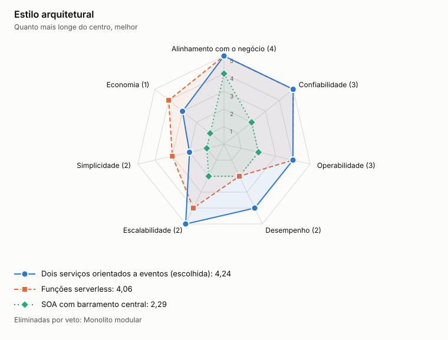

# ADR-0001: Estilo arquitetural

- **Status:** aceita
- **Data:** 2026-11-05

## Contexto

O comerciante precisa registrar lançamentos mesmo se o relatório cair. O sistema tem duas cargas diferentes: escrita transacional e leitura em picos de 50 req/s.

## Decisão

Construir dois serviços independentes, Lançamentos e Consolidado, cada um com processo, banco e deploy próprios, integrados por eventos. Dentro de cada serviço, usar arquitetura hexagonal.

## Opções

<!-- radar:start -->

| Critério | Peso | **Dois serviços orientados a eventos** | Funções serverless | SOA com barramento central | Monolito modular |
|---|---:|---:|---:|---:|---:|
| Alinhamento com o negócio | 4 | 5 | 5 | 4 | Veto |
| Confiabilidade | 3 | 5 | 5 | 2 | Veto |
| Operabilidade | 3 | 4 | 4 | 2 | 5 |
| Desempenho | 2 | 4 | 2 | 2 | 4 |
| Escalabilidade | 2 | 5 | 4 | 2 | 3 |
| Simplicidade | 2 | 2 | 3 | 1 | 5 |
| Economia | 1 | 3 | 4 | 1 | 4 |
| **Resultado** | | **4,24** | **4,06** | **2,29** | Eliminada |

As perguntas e a evidência de cada nota estão na [avaliação dos radares](../21-avaliacao-dos-radares.md#adr-0001).
<!-- radar:end -->

## Leitura do radar

Confiabilidade é o pilar decisivo, porque atende ao requisito central. O monolito modular ganha em simplicidade e custo, mas compartilha processo, banco e ciclo de deploy, então uma falha pode atingir os lançamentos. Funções serverless também isolam falhas, mas pioram a latência em partida a frio e dificultam a execução local.

SOA com barramento perde por ser desproporcional: um barramento central é demais para dois serviços. O monolito foi eliminado por veto, porque o mesmo processo faria a escrita depender do consolidado.

## Consequências

**Positivas**

- Falhas e picos do consolidado não afetam os lançamentos
- Cada serviço escala e evolui separadamente

**Negativas**

- O saldo passa a ter consistência eventual
- Há mais componentes para operar e observar

## Gatilho de revisão

Rever se o negócio exigir saldo com consistência imediata, ou se novos contextos justificarem separar mais serviços.
