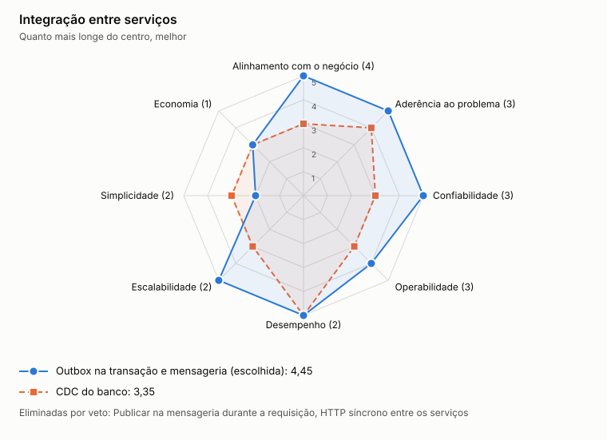

# ADR-0002: Integração entre serviços

- **Status:** aceita
- **Data:** 2026-11-05

## Contexto

O consolidado precisa saber de cada lançamento. Gravar no banco e publicar na mensageria são duas operações sem transação comum, e uma falha entre elas pode perder um evento ou publicar um fato que não existe.

## Decisão

Usar transactional outbox. O lançamento e o evento são gravados na mesma transação, e um publicador envia o evento depois. A entrega é at-least-once, e o consumidor é idempotente.

## Opções

<!-- radar:start -->

| Pilar | **Outbox e mensageria** | HTTP síncrono | CDC do banco |
|---|---:|---:|---:|
| Segurança | 4 | 4 | 3 |
| Desempenho | 4 | 3 | 4 |
| Escalabilidade | 5 | 2 | 5 |
| Confiabilidade | 5 | 1 | 4 |
| Custo | 4 | 5 | 2 |
| Simplicidade | 3 | 5 | 2 |
| Operabilidade | 3 | 4 | 2 |
<!-- radar:end -->

## Leitura do radar

HTTP síncrono é a opção mais simples, mas cria a dependência que o requisito proíbe, por isso recebe nota 1 em confiabilidade. CDC também evita a escrita dupla, mas acrescenta um conector, mais operação e expõe o esquema interno do banco.

Publicar direto na mensageria durante a requisição foi descartado: a queda do broker impediria os lançamentos.

## Consequências

**Positivas**

- Nenhum lançamento confirmado perde seu evento
- Lançamentos aceita escrita com o broker ou o consolidado fora do ar

**Negativas**

- Eventos podem chegar repetidos ou fora de ordem
- A outbox precisa de publicador, limpeza e monitoramento

## Gatilho de revisão

Rever se o volume tornar a leitura da outbox um gargalo. CDC passa a ser a alternativa natural.
