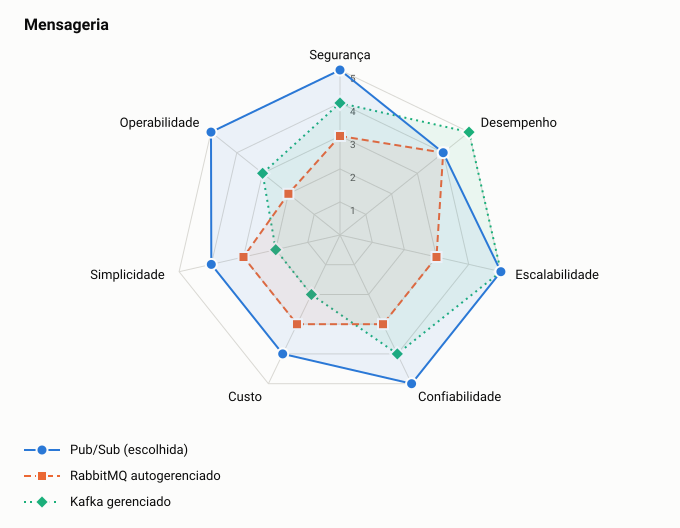

# ADR-0003: Mensageria

- **Status:** aceita
- **Data:** 2026-11-05

## Contexto

O alvo é GCP. A mensageria precisa de durabilidade, retentativas e fila de mensagens mortas, com pouca operação para a equipe.

## Decisão

Usar Pub/Sub, com tópico de mensagens mortas. O ambiente local usa o emulador, com RabbitMQ como plano B, atrás da mesma interface.

## Opções

<!-- radar:start -->

| Pilar | **Pub/Sub** | RabbitMQ autogerenciado | Kafka gerenciado |
|---|---:|---:|---:|
| Segurança | 5 | 3 | 4 |
| Desempenho | 4 | 4 | 5 |
| Escalabilidade | 5 | 3 | 5 |
| Confiabilidade | 5 | 3 | 4 |
| Custo | 4 | 3 | 2 |
| Simplicidade | 4 | 3 | 2 |
| Operabilidade | 5 | 2 | 3 |
<!-- radar:end -->

## Leitura do radar

Pub/Sub é gerenciado e integrado ao IAM do GCP, o que explica as notas em segurança e operabilidade. RabbitMQ exigiria operar um cluster próprio. Kafka tem o melhor desempenho e permite reprocessar histórico, mas custa e pesa mais do que esse volume justifica.

## Consequências

**Positivas**

- Sem cluster para operar, com alta disponibilidade gerenciada
- Permissões por tópico e assinatura usando IAM

**Negativas**

- A ordem não é garantida por padrão, então o consumidor não pode depender dela
- O teste local usa emulador, que pode diferir do serviço real. As mensagens mortas foram validadas no emulador, com 5 tentativas antes do desvio
- Mensagens enviadas a um tópico sem assinatura são descartadas, então a assinatura precisa ser provisionada antes da primeira publicação

## Gatilho de revisão

Rever se surgirem vários consumidores que precisem reprocessar histórico longo. Nesse caso, Kafka volta à mesa.
