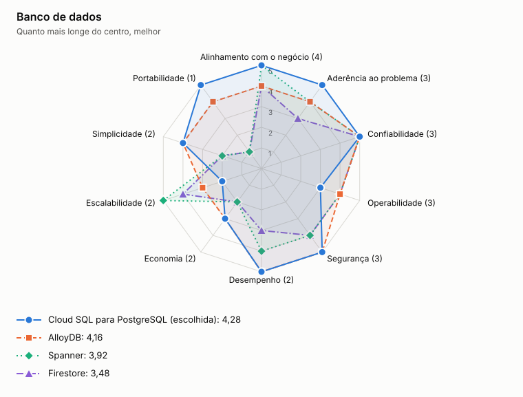

# ADR-0004: Banco de dados

- **Status:** aceita
- **Data:** 2026-11-05

## Contexto

Lançamentos exige transação entre o registro e a outbox. O consolidado agrega valores por dia. Os dados são financeiros, relacionais e de volume moderado.

## Decisão

Usar PostgreSQL em instâncias separadas por serviço, com Cloud SQL em alta disponibilidade regional no alvo.

## Opções

<!-- radar:start -->

| Pilar | **Cloud SQL para PostgreSQL** | Spanner | Firestore |
|---|---:|---:|---:|
| Segurança | 4 | 5 | 4 |
| Desempenho | 4 | 4 | 4 |
| Escalabilidade | 3 | 5 | 5 |
| Confiabilidade | 4 | 5 | 4 |
| Custo | 4 | 1 | 4 |
| Simplicidade | 5 | 3 | 3 |
| Operabilidade | 4 | 4 | 5 |
<!-- radar:end -->

## Leitura do radar

Spanner tem a melhor escala e confiabilidade, mas seu custo não se justifica para esse volume. Firestore escala bem, mas agregações por período e restrições relacionais ficariam na aplicação. PostgreSQL oferece transações, restrições e SQL com a menor complexidade.

## Consequências

**Positivas**

- Transações ACID sustentam a outbox e a idempotência
- O mesmo motor roda localmente e no alvo

**Negativas**

- A escrita escala verticalmente até haver particionamento
- Há duas instâncias para manter

## Gatilho de revisão

Rever se a escrita se aproximar do limite da instância após otimizações. O caminho é particionar por comerciante ou avaliar Spanner.
