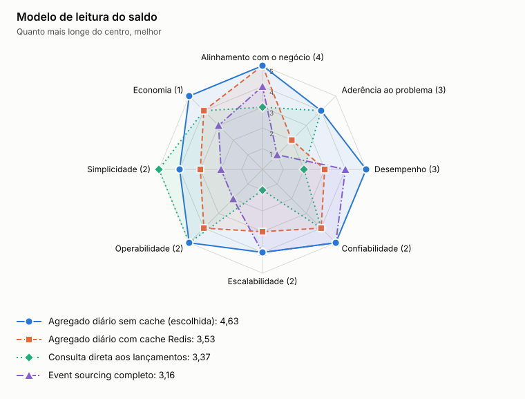

# ADR-0005: Modelo de leitura do saldo

- **Status:** aceita
- **Data:** 2026-11-05

## Contexto

O relatório precisa atender 50 req/s sem depender de Lançamentos. Um lançamento retroativo muda o fechamento daquele dia e a abertura dos dias seguintes.

## Decisão

Manter uma tabela de créditos e débitos por comerciante e dia, atualizada por eventos, com o acumulado calculado na consulta e cache em Redis. A chave do cache leva uma versão por comerciante, que muda a cada atualização.

## Opções

<!-- radar:start -->

| Pilar | **Agregado diário e cache** | Consulta aos lançamentos | Event sourcing completo |
|---|---:|---:|---:|
| Segurança | 4 | 3 | 4 |
| Desempenho | 5 | 2 | 4 |
| Escalabilidade | 5 | 2 | 4 |
| Confiabilidade | 4 | 2 | 5 |
| Custo | 4 | 4 | 2 |
| Simplicidade | 4 | 5 | 1 |
| Operabilidade | 4 | 3 | 2 |
<!-- radar:end -->

## Leitura do radar

Consultar os lançamentos diretamente é simples, mas cria dependência entre os serviços e faz cada leitura custar mais. Event sourcing completo dá histórico e reconstrução, mas o custo de aprendizado e de operação não se paga. O agregado diário entrega quase o mesmo resultado, porque somas não dependem da ordem dos eventos e Lançamentos continua sendo a fonte para reconstrução.

## Consequências

**Positivas**

- Leitura rápida e isolada dos lançamentos
- Evento fora de ordem ou retroativo altera apenas uma linha

**Negativas**

- O saldo pode ficar alguns segundos atrás, então a resposta informa `updatedThrough`
- A abertura soma o histórico do comerciante, o que pode pedir fotografias mensais no futuro

## Gatilho de revisão

Rever se o histórico por comerciante deixar a soma lenta. O próximo passo são fotografias mensais do saldo.
