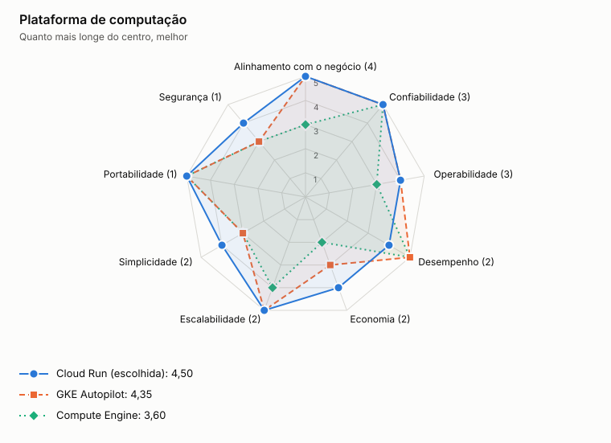

# ADR-0006: Plataforma de computação

- **Status:** aceita
- **Data:** 2026-11-05

## Contexto

Os serviços são contêineres sem estado, com carga variável. A equipe de operação deve ser pequena para esse sistema.

## Decisão

Usar Cloud Run com instância mínima, com o publicador e o consumidor em CPU sempre alocada.

## Opções

<!-- radar:start -->

| Pilar | **Cloud Run** | GKE Autopilot | Compute Engine |
|---|---:|---:|---:|
| Segurança | 4 | 4 | 3 |
| Desempenho | 4 | 5 | 4 |
| Escalabilidade | 5 | 5 | 3 |
| Confiabilidade | 4 | 5 | 3 |
| Custo | 4 | 3 | 3 |
| Simplicidade | 5 | 2 | 3 |
| Operabilidade | 5 | 3 | 2 |
<!-- radar:end -->

## Leitura do radar

GKE tem mais controle e o melhor resultado em confiabilidade, mas exige mais operação. Compute Engine traz trabalho de sistema operacional sem vantagem aqui. Se o padrão do cliente for GKE, a troca é simples, porque os serviços já são contêineres.

## Consequências

**Positivas**

- Escala automática e operação reduzida
- Pagamento proporcional ao uso

**Negativas**

- Menos controle de rede e de execução do que no Kubernetes
- Processos contínuos precisam de configuração própria para não serem suspensos

## Gatilho de revisão

Rever se o cliente tiver GKE como padrão, ou se a quantidade de serviços crescer.
