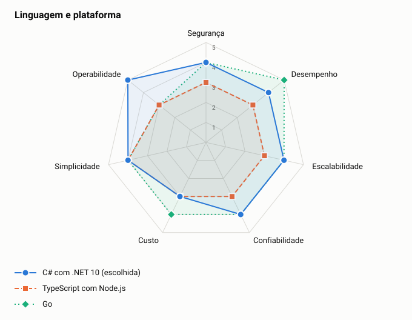

# ADR-0007: Linguagem e plataforma

- **Status:** aceita
- **Data:** 2026-11-05

## Contexto

O PDF aceita a linguagem que o autor domina. O cliente mantém sua stack principal em C#.

## Decisão

Usar C# com .NET 10 LTS e ASP.NET Core.

## Opções

<!-- radar:start -->

| Critério | Peso | **C# com .NET 10** | Go | Java com Spring Boot | TypeScript com Node.js |
|---|---:|---:|---:|---:|---:|
| Alinhamento com o negócio | 4 | 5 | 2 | 2 | 2 |
| Operabilidade | 3 | 5 | 4 | 4 | 4 |
| Desempenho | 2 | 5 | 5 | 4 | 4 |
| Simplicidade | 2 | 5 | 3 | 4 | 4 |
| Economia | 1 | 4 | 3 | 3 | 3 |
| **Resultado** | | **4,92** | **3,25** | **3,25** | **3,25** |

As perguntas e a evidência de cada nota estão na [avaliação dos radares](../21-avaliacao-dos-radares.md#adr-0007).
<!-- radar:end -->

## Leitura do radar

Go empata com C# em desempenho, mas perde em operabilidade, que pesa mais aqui: quem vai manter o sistema é uma equipe que já domina C#. O .NET moderno entrega bom desempenho, com suporte de longo prazo e bibliotecas maduras. TypeScript não traz vantagem para este caso.

## Consequências

**Positivas**

- Alinhamento com a equipe e o ecossistema do cliente
- Suporte de longo prazo e ferramentas maduras

**Negativas**

- Imagens e consumo de memória maiores que os de Go
- Partida a frio mais lenta, atenuada por instância mínima

## Decisão do arquiteto

C# é a stack da empresa, mas é uma preferência de negócio, e não uma restrição. Por isso, as outras linguagens perdem em Alinhamento, sem serem eliminadas.

## Gatilho de revisão

Rever se a empresa adotar outra plataforma padrão, ou se o custo de memória se tornar relevante.
