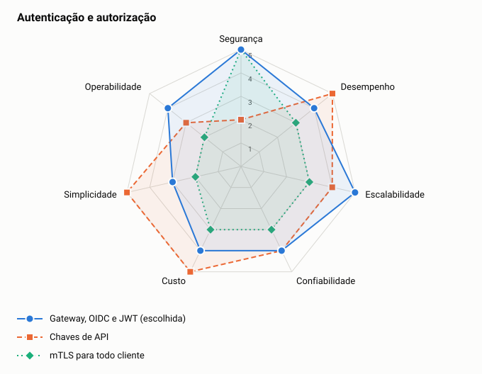

# ADR-0008: Autenticação e autorização

- **Status:** aceita
- **Data:** 2026-11-05

## Contexto

Os dados são financeiros e isolados por comerciante. A autorização precisa ser auditável e separar leitura de escrita.

## Decisão

Usar OAuth2 e OIDC com JWT de vida curta. O gateway faz a primeira validação, e cada serviço valida o token novamente. O `merchantId` vem do token, nunca da rota. Serviços usam identidades próprias no GCP.

## Opções

<!-- radar:start -->

| Pilar | **Gateway, OIDC e JWT** | Chaves de API | mTLS para todo cliente |
|---|---:|---:|---:|
| Segurança | 5 | 2 | 5 |
| Desempenho | 4 | 5 | 3 |
| Escalabilidade | 5 | 4 | 3 |
| Confiabilidade | 4 | 4 | 3 |
| Custo | 4 | 5 | 3 |
| Simplicidade | 3 | 5 | 2 |
| Operabilidade | 4 | 3 | 2 |
<!-- radar:end -->

## Leitura do radar

Chaves de API são simples, mas não expiram sozinhas e têm autorização fraca. mTLS para todo cliente é forte, mas pesado de distribuir e renovar para comerciantes. Ele fica como opção para integrações de sistema a sistema de maior risco.

## Consequências

**Positivas**

- Um comerciante não acessa dados de outro, mesmo se a rota for manipulada
- Tokens curtos e escopos reduzem o dano de um vazamento

**Negativas**

- Depende da disponibilidade do provedor de identidade
- Exige gestão de chaves e de clientes

## Gatilho de revisão

Rever se houver integrações reguladas com perfis como FAPI. Nesse caso, mTLS e tokens vinculados ao certificado passam a ser exigidos.
