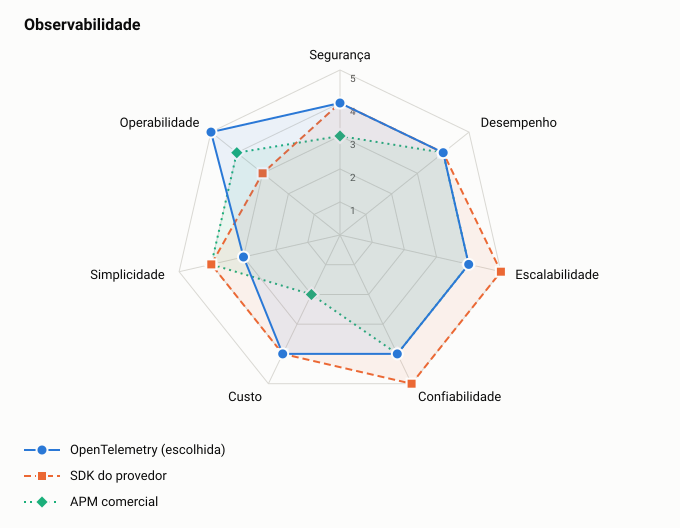

# ADR-0009: Observabilidade

- **Status:** aceita
- **Data:** 2026-11-05

## Contexto

O sistema é assíncrono, então uma falha pode acontecer longe da requisição que a causou. O rastreamento precisa acompanhar o lançamento até o saldo.

## Decisão

Instrumentar com OpenTelemetry. Localmente, usar Prometheus e Grafana. No GCP, exportar para o Google Cloud Observability.

## Opções

<!-- radar:start -->

| Pilar | **OpenTelemetry** | SDK do provedor | APM comercial |
|---|---:|---:|---:|
| Segurança | 4 | 4 | 3 |
| Desempenho | 4 | 4 | 4 |
| Escalabilidade | 4 | 5 | 4 |
| Confiabilidade | 4 | 5 | 4 |
| Custo | 4 | 4 | 2 |
| Simplicidade | 3 | 4 | 4 |
| Operabilidade | 5 | 3 | 4 |
<!-- radar:end -->

## Leitura do radar

O SDK do provedor é mais direto e integrado, mas prende a instrumentação ao GCP e não funciona igual no ambiente local. O APM comercial é forte em experiência, com custo maior. OpenTelemetry mantém o mesmo código nos dois ambientes.

## Consequências

**Positivas**

- A mesma instrumentação serve no local e na nuvem
- O backend pode mudar sem alterar o código

**Negativas**

- Exige mais configuração inicial
- O coletor é mais um componente para operar

## Resultado

Implementado no M6. `smoke.sh` prova que um traço liga a API, o publicador e o consumidor, e que a queda do coletor não afeta a escrita. O custo medido da telemetria está nos [resultados de testes](../09-resultados-de-testes.md).

## Gatilho de revisão

Rever se o cliente tiver um APM corporativo. Nesse caso, basta trocar o destino do coletor.
