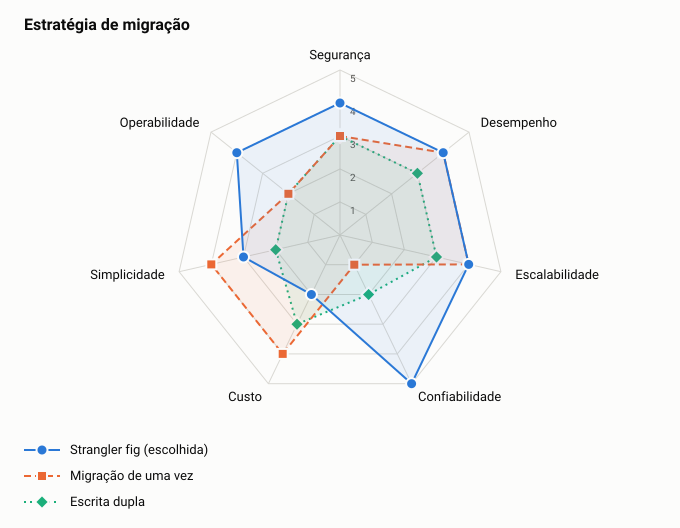

# ADR-0010: Estratégia de migração

- **Status:** aceita
- **Data:** 2026-11-06

## Contexto

Em um cenário com legado, a mudança não pode interromper o registro de lançamentos nem gerar saldos diferentes entre os sistemas. O cenário de legado é uma premissa deste projeto.

## Decisão

Usar o padrão strangler fig, com um gateway de roteamento, comparação de saldos e migração por grupos de comerciantes. Cada comerciante escreve em um único sistema por vez.

## Opções

<!-- radar:start -->

| Critério | Peso | **Strangler fig, por fases** | Migração de uma vez | Escrita dupla nos dois sistemas |
|---|---:|---:|---:|---:|
| Alinhamento com o negócio | 4 | 5 | 2 | Veto |
| Aderência ao problema | 3 | 4 | 4 | Veto |
| Confiabilidade | 3 | 4 | 2 | Veto |
| Operabilidade | 2 | 5 | 3 | 4 |
| Simplicidade | 2 | 3 | 4 | 3 |
| Economia | 1 | 2 | 4 | 2 |
| **Resultado** | | **4,13** | **2,93** | Eliminada |

As perguntas e a evidência de cada nota estão na [avaliação dos radares](../21-avaliacao-dos-radares.md#adr-0010).
<!-- radar:end -->

## Leitura do radar

A migração de uma vez é a mais simples e a mais barata em tempo, mas concentra todo o risco em uma janela e tem retorno difícil. A escrita dupla parece segura, mas é o mesmo problema que a outbox resolve: duas gravações sem transação comum geram divergência. O strangler fig custa mais e dura mais, mas permite parar e voltar em cada fase, e a confiabilidade é o critério decisivo em um sistema financeiro.

## Consequências

**Positivas**

- Cada fase tem critério de avanço e plano de retorno
- Comerciantes migram aos poucos, o que limita o impacto de um erro

**Negativas**

- Dois sistemas convivem por mais tempo, com custo duplicado
- Gateway, CDC e comparador são componentes temporários que precisam ser construídos

## Gatilho de revisão

Rever se o legado real for pequeno o bastante para uma janela de manutenção aceita pelo negócio.
