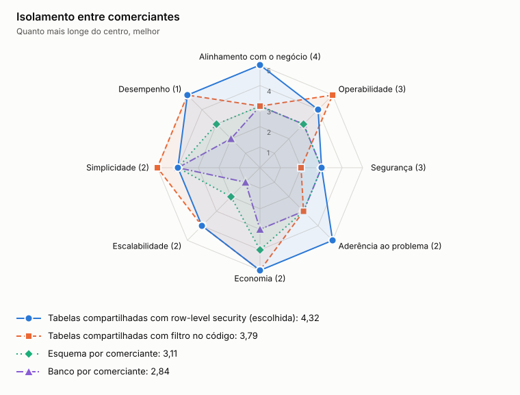

# ADR-0011: Isolamento entre comerciantes

- **Status:** aceita
- **Data:** 2026-11-06
- **Registro:** escrito depois da implementação, para documentar uma escolha que já estava no código

## Contexto

O sistema atende vários comerciantes. O dado de um nunca pode alcançar outro, e o custo por comerciante precisa ficar baixo, porque a base pode ter muitos clientes pequenos.

## Decisão

Usar tabelas compartilhadas, com `merchant_id` em toda linha e em toda consulta, e row-level security do PostgreSQL como segunda barreira. Cada transação da API e do consumidor do consolidado define o comerciante, e sem isso o banco não devolve nenhuma linha. Registro de outro comerciante responde 404, para não revelar que ele existe.

As aplicações usam papéis próprios, sem superusuário. A API não tem permissão de alterar nem excluir lançamentos. Só o publicador de Lançamentos, que lê a outbox de todos os comerciantes, usa um papel que ignora o RLS.

## Opções

<!-- radar:start -->

| Critério | Peso | **Tabelas compartilhadas com row-level security** | Tabelas compartilhadas com filtro no código | Esquema por comerciante | Banco por comerciante |
|---|---:|---:|---:|---:|---:|
| Alinhamento com o negócio | 4 | 5 | 3 | 3 | 3 |
| Operabilidade | 3 | 4 | 5 | 3 | 3 |
| Segurança | 3 | 3 | 2 | 3 | 3 |
| Aderência ao problema | 2 | 5 | 3 | 3 | 3 |
| Economia | 2 | 5 | 5 | 4 | 3 |
| Escalabilidade | 2 | 4 | 4 | 2 | 1 |
| Simplicidade | 2 | 4 | 5 | 4 | 4 |
| Desempenho | 1 | 5 | 5 | 3 | 2 |
| **Resultado** | | **4,32** | **3,79** | **3,11** | **2,84** |

As perguntas e a evidência de cada nota estão na [avaliação dos radares](../21-avaliacao-dos-radares.md#adr-0011).
<!-- radar:end -->

## Leitura do radar

Banco por comerciante isola fisicamente, mas multiplica credenciais e fica com a mesma nota de RLS em segurança, enquanto o custo e a operação crescem com cada cliente. Esquema por comerciante melhora pouco e multiplica migrações. Tabelas compartilhadas só com filtro no código deixam o isolamento depender de cada consulta. Com RLS, o banco aplica o isolamento, e o modelo continua simples e barato.

## Consequências

**Positivas**

- Uma migração atende todos os comerciantes
- Custo não cresce com o número de clientes

**Negativas**

- Cada leitura precisa de uma transação para definir o comerciante, com idas a mais ao banco
- O publicador de Lançamentos ignora o RLS, então depende do código e do controle de acesso ao papel
- Uma chamada a mais por evento no consumidor, para definir o comerciante
- Um comerciante muito grande afeta os demais no mesmo banco

## Revisão de 2026-11-06

A decisão original deixava o isolamento só no código. A reavaliação às cegas favoreceu o RLS, porque esse modelo é fraco para uma instituição financeira, e o RLS foi adotado.

## Revisão de 2026-11-09

Na primeira versão, o consumidor do consolidado também ignorava o RLS. Como o comerciante de cada evento já é conhecido, a migração V003 retirou dele o `BYPASSRLS`, e ele passou a definir o comerciante em cada transação (D-146).

## Gatilho de revisão

Rever se um cliente exigir isolamento físico por contrato ou regulação.
