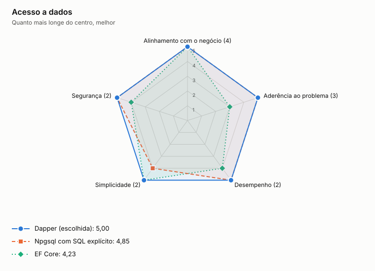

# ADR-0012: Acesso a dados

- **Status:** aceita
- **Data:** 2026-11-06
- **Registro:** escrito depois da implementação, para documentar uma escolha que já estava no código

## Contexto

Cada serviço tem poucas consultas, e as mais importantes usam recursos próprios do PostgreSQL: `FOR UPDATE SKIP LOCKED` na outbox e `ON CONFLICT` na idempotência e no agregado.

## Decisão

Usar Dapper sobre Npgsql, com SQL escrito à mão dentro dos adaptadores de infraestrutura. O domínio só conhece as portas.

## Opções

<!-- radar:start -->

| Critério | Peso | **Dapper** | Npgsql com SQL explícito | EF Core |
|---|---:|---:|---:|---:|
| Alinhamento com o negócio | 4 | 5 | 5 | 5 |
| Aderência ao problema | 3 | 5 | 5 | 3 |
| Desempenho | 2 | 5 | 5 | 4 |
| Simplicidade | 2 | 5 | 4 | 5 |
| **Resultado** | | **5,00** | **4,82** | **4,27** |

As perguntas e a evidência de cada nota estão na [avaliação dos radares](../21-avaliacao-dos-radares.md#adr-0012).
<!-- radar:end -->

## Leitura do radar

As notas ficaram próximas, e nenhuma opção compromete um requisito. Dapper reduz o código de leitura e mantém visível o SQL que sustenta as garantias, ao custo de uma dependência a mais. EF Core ajudaria num modelo grande, mas aqui seus benefícios são pequenos, e as consultas críticas precisariam de SQL de qualquer forma.

## Consequências

**Positivas**

- O SQL que sustenta as garantias fica à vista na revisão
- Sem camada entre o código e o banco para ajustar ou diagnosticar

**Negativas**

- O mapeamento de colunas só falha em execução, por isso há testes de integração com PostgreSQL real
- Mais uma dependência, e tipos como `DateOnly` precisam de um conversor

## Revisão de 2026-11-06

A primeira versão usava Npgsql direto. A reavaliação às cegas favoreceu o Dapper, que elimina o mapeamento manual e mantém o SQL explícito, e a troca foi feita.

## Gatilho de revisão

Rever se o número de consultas crescer muito ou se o mapeamento manual passar a gerar defeitos. O próximo passo é um ORM, sem mudar as portas.
