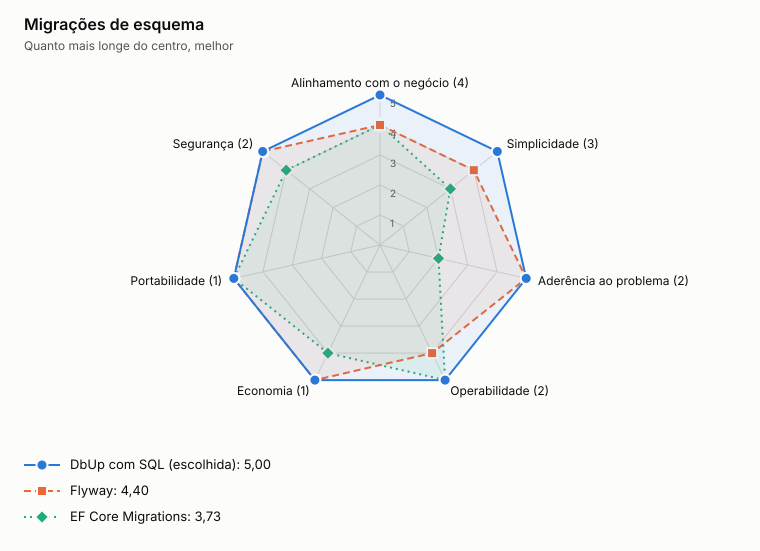

# ADR-0013: Migrações de esquema

- **Status:** aceita
- **Data:** 2026-11-06
- **Registro:** escrito depois da implementação, para documentar uma escolha que já estava no código

## Contexto

O esquema precisa evoluir de forma versionada e repetível. Em nuvem, várias instâncias sobem juntas, e migrar na subida de cada uma disputaria o banco.

## Decisão

Usar DbUp com arquivos SQL embutidos no projeto de infraestrutura. A migração roda uma vez, pela opção `--migrate`, antes de a API subir.

## Opções

<!-- radar:start -->

| Pilar | **DbUp com SQL** | EF Core Migrations | Flyway |
|---|---:|---:|---:|
| Segurança | 4 | 4 | 4 |
| Desempenho | 4 | 4 | 4 |
| Escalabilidade | 4 | 4 | 4 |
| Confiabilidade | 4 | 3 | 4 |
| Custo | 5 | 5 | 4 |
| Simplicidade | 4 | 3 | 3 |
| Operabilidade | 4 | 3 | 4 |
<!-- radar:end -->

## Leitura do radar

EF Core Migrations pressupõe o EF Core, descartado no ADR-0012. Flyway é maduro, mas traz outra ferramenta e outro ambiente de execução para uma stack .NET. DbUp mantém o SQL explícito e cabe no próprio binário do serviço.

## Consequências

**Positivas**

- O mesmo artefato do serviço aplica o esquema
- A migração tem sua própria falha, separada da subida da API

**Negativas**

- DbUp só avança: desfazer uma mudança exige uma nova migração
- A compatibilidade entre versões do esquema e do código depende de disciplina

## Gatilho de revisão

Rever se o projeto precisar de migrações com reversão automática ou de relatórios de drift entre ambientes.
