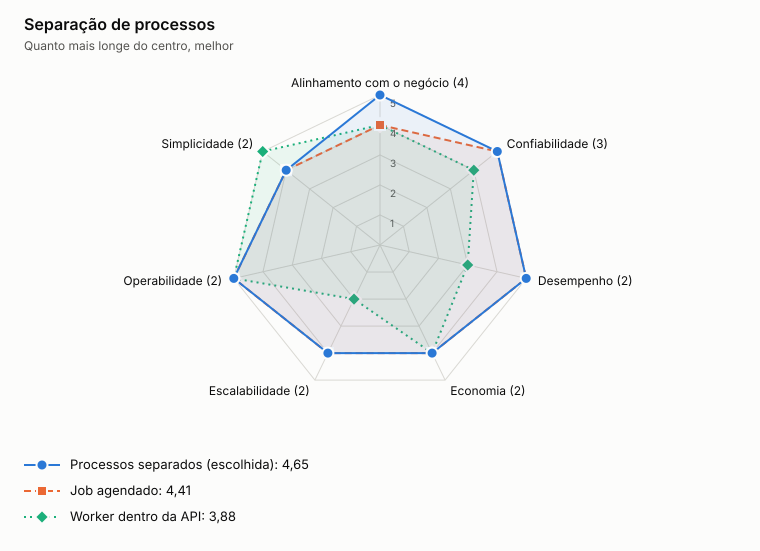

# ADR-0014: Separação de processos

- **Status:** aceita
- **Data:** 2026-11-06
- **Registro:** escrito depois da implementação, para documentar uma escolha que já estava no código

## Contexto

Cada serviço faz trabalho síncrono, que atende requisições, e trabalho contínuo, que envia ou consome eventos. No Cloud Run, os dois tipos têm perfis diferentes de escala e de CPU.

## Decisão

Separar `ledger-api`, `outbox-publisher`, `consolidation-api` e `consolidation-consumer` em processos próprios, com o mesmo código de domínio em cada serviço.

## Opções

<!-- radar:start -->

| Critério | Peso | **Processos separados** | Job agendado | Worker dentro da API |
|---|---:|---:|---:|---:|
| Alinhamento com o negócio | 4 | 5 | 4 | 4 |
| Confiabilidade | 3 | 5 | 5 | 4 |
| Desempenho | 2 | 5 | 5 | 3 |
| Economia | 2 | 4 | 4 | 4 |
| Escalabilidade | 2 | 4 | 4 | 2 |
| Operabilidade | 2 | 5 | 5 | 5 |
| Simplicidade | 2 | 4 | 4 | 5 |
| **Resultado** | | **4,65** | **4,41** | **3,88** |

As perguntas e a evidência de cada nota estão na [avaliação dos radares](../21-avaliacao-dos-radares.md#adr-0014).
<!-- radar:end -->

## Leitura do radar

Colocar o worker dentro da API custa menos e é mais simples, mas uma fila acumulada tiraria recursos das requisições, e a escala por requisição multiplicaria consumidores sem controle. Um job agendado aumentaria a defasagem do saldo. Pagamos mais por isolar as falhas, o que atende ao requisito central.

## Consequências

**Positivas**

- Cada processo escala e falha sozinho
- Publicador ou consumidor parado não afeta as APIs

**Negativas**

- Mais artefatos para implantar e observar
- O publicador e o consumidor precisam de instância ativa, o que aumenta o custo fixo

## Gatilho de revisão

Rever se o custo fixo dos workers pesar num volume muito baixo. Nesse caso, um job frequente pode trocar defasagem por custo.
