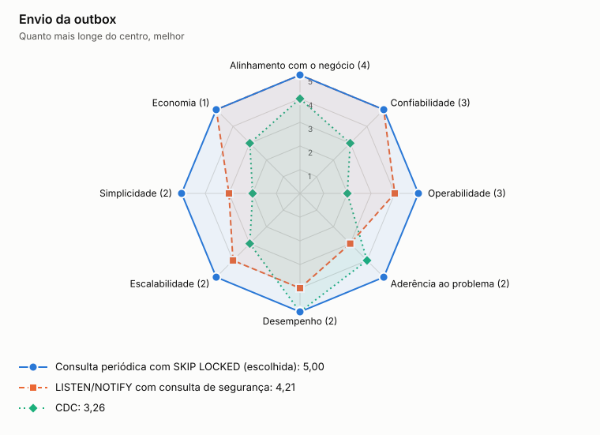

# ADR-0015: Envio da outbox

- **Status:** aceita
- **Data:** 2026-11-06
- **Registro:** escrito depois da implementação, para documentar uma escolha que já estava no código

## Contexto

Os eventos gravados na outbox precisam chegar à mensageria sem perda e sem exigir componentes novos. O ADR-0002 já escolheu a outbox, e este ADR decide como ela é lida.

## Decisão

Consultar a outbox em lotes, com `FOR UPDATE SKIP LOCKED`, publicar cada evento e marcar `published_at` na mesma transação da leitura. Eventos são publicados em sequência, e a falha interrompe o lote.

## Opções

<!-- radar:start -->

| Pilar | **Consulta periódica** | LISTEN/NOTIFY | CDC |
|---|---:|---:|---:|
| Segurança | 4 | 4 | 3 |
| Desempenho | 3 | 4 | 5 |
| Escalabilidade | 3 | 3 | 5 |
| Confiabilidade | 5 | 4 | 4 |
| Custo | 5 | 5 | 2 |
| Simplicidade | 5 | 3 | 2 |
| Operabilidade | 4 | 3 | 2 |
<!-- radar:end -->

## Leitura do radar

LISTEN/NOTIFY reduz a espera, mas ainda precisa da consulta para não perder avisos, então acrescenta um caminho sem remover o outro. CDC tem a melhor vazão, mas pede outra plataforma para operar. A consulta periódica tem a menor vazão, que é suficiente: a defasagem medida é de segundos, e o `SKIP LOCKED` permite mais de um publicador.

## Consequências

**Positivas**

- Sem componente novo além do banco e da mensageria
- Falha no meio do lote preserva o que já foi confirmado

**Negativas**

- A transação e a conexão ficam abertas durante a publicação do lote, então um broker lento prende recursos
- A publicação em sequência limita a vazão
- Quando a fila está vazia, a consulta roda a cada 200 ms mesmo sem eventos
- Se o commit falhar depois de publicar, os eventos saem de novo, por isso o consumidor é idempotente

## Gatilho de revisão

Rever se a vazão de escrita passar do que um publicador sequencial entrega. O primeiro passo é publicar o lote em paralelo. Depois, CDC.
