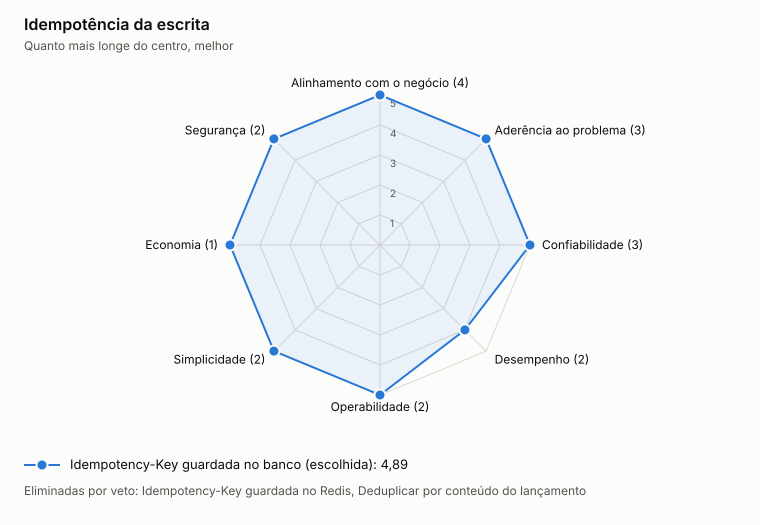

# ADR-0016: Idempotência da escrita

- **Status:** aceita
- **Data:** 2026-11-06
- **Registro:** escrito depois da implementação, para documentar uma escolha que já estava no código

## Contexto

Cliente que não recebe resposta tenta de novo, e um lançamento duplicado é um erro financeiro. A garantia precisa valer mesmo com duas requisições simultâneas e sem depender de outro serviço, conforme o princípio P1.

## Decisão

Exigir `Idempotency-Key` de 8 a 128 caracteres nas escritas. A chave fica em `idempotency_key`, na mesma transação do lançamento, com o hash do pedido. A mesma chave com outro conteúdo é rejeitada. A unicidade do banco resolve a disputa entre requisições.

## Opções

<!-- radar:start -->

| Critério | Peso | **Idempotency-Key guardada no banco** | Idempotency-Key guardada no Redis | Deduplicar por conteúdo do lançamento |
|---|---:|---:|---:|---:|
| Alinhamento com o negócio | 4 | 5 | 4 | Veto |
| Aderência ao problema | 3 | 5 | Veto | Veto |
| Confiabilidade | 3 | 5 | 3 | Veto |
| Desempenho | 2 | 4 | 4 | 5 |
| Operabilidade | 2 | 5 | 3 | 5 |
| Simplicidade | 2 | 5 | 3 | 5 |
| Economia | 1 | 5 | 3 | 5 |
| **Resultado** | | **4,88** | Eliminada | Eliminada |

As perguntas e a evidência de cada nota estão na [avaliação dos radares](../21-avaliacao-dos-radares.md#adr-0016).
<!-- radar:end -->

## Leitura do radar

A chave no Redis é mais rápida, mas colocaria o cache no caminho de toda escrita, contrariando o P1, e uma queda do cache permitiria duplicar lançamentos. Deduplicar por conteúdo bloquearia dois lançamentos legítimos iguais no mesmo dia. A chave no banco custa uma gravação a mais e dá a garantia na mesma transação.

## Consequências

**Positivas**

- Lançamento e chave são gravados juntos, ou nenhum dos dois
- A repetição devolve o lançamento original

**Negativas**

- Toda escrita faz uma gravação a mais
- O cliente precisa gerar e guardar a chave
- A tabela cresce sem limite até haver política de retenção

## Gatilho de revisão

Rever quando o volume de `idempotency_key` pedir retenção. O prazo precisa ser maior que a janela de nova tentativa dos clientes.
