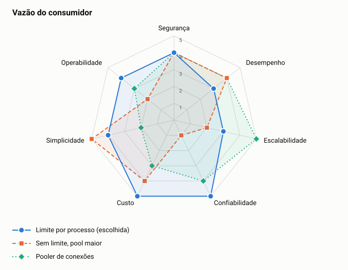

# ADR-0017: Vazão do consumidor

- **Status:** aceita
- **Data:** 2026-11-06
- **Registro:** escrito depois da implementação, para documentar uma escolha que já estava no código

## Contexto

No teste de resiliência, a fila acumulada durante uma queda esgotou as conexões do banco quando o consumidor voltou, e a API de saldo passou a falhar com "too many clients". A recuperação de um componente derrubou outro.

## Decisão

Limitar o consumidor a 16 eventos em processamento, com um único cliente de assinatura por processo e pool de conexões definido.

## Opções

<!-- radar:start -->

| Critério | Peso | **Limite fixo de eventos em processamento** | Pooler de conexões | Sem limite, com pool de conexões maior |
|---|---:|---:|---:|---:|
| Alinhamento com o negócio | 4 | 5 | 4 | Veto |
| Confiabilidade | 3 | 5 | 3 | 3 |
| Desempenho | 3 | 5 | 2 | 2 |
| Escalabilidade | 2 | 3 | 4 | Veto |
| Operabilidade | 2 | 5 | 3 | 4 |
| Simplicidade | 2 | 5 | 3 | 5 |
| Economia | 1 | 5 | 3 | 4 |
| **Resultado** | | **4,76** | **3,18** | Eliminada |

As perguntas e a evidência de cada nota estão na [avaliação dos radares](../21-avaliacao-dos-radares.md#adr-0017).
<!-- radar:end -->

## Leitura do radar

Aumentar o pool só adia o problema e foi o que falhou no teste. Um pooler resolve melhor em escala, mas é mais um componente para um risco que o limite já trata. O limite deixa a fila esvaziar mais devagar, o que é aceitável: o teste terminou com saldo exato 3 s depois do fim da carga na primeira medição e 1 s na atual, e sem nenhuma leitura com falha.

## Consequências

**Positivas**

- A leitura segue atendendo enquanto a fila é consumida
- O total de conexões fica previsível, o que permite o orçamento do documento de observabilidade

**Negativas**

- A recuperação de uma fila grande demora mais
- 16 resolveu o caso medido, mas não é um valor otimizado

## Gatilho de revisão

Rever se o tempo de recuperação da fila passar do aceitável. Aumente instâncias dentro do orçamento de conexões e, depois, adote um pooler.
