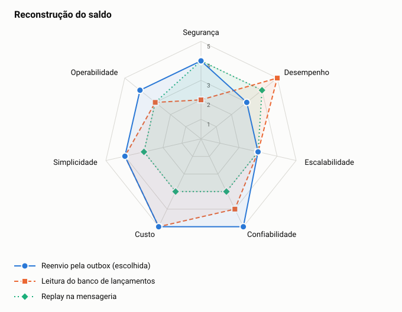

# ADR-0018: Reconstrução do saldo

- **Status:** aceita
- **Data:** 2026-11-06
- **Registro:** escrito depois da implementação, para documentar uma escolha que já estava no código

## Contexto

O consolidado é derivado e precisa poder ser refeito depois de uma perda ou de um defeito. O princípio P3 proíbe que um serviço leia o banco do outro.

## Decisão

Parar o consumidor, zerar o consolidado com `--reset`, recolocar os lançamentos na outbox com `--republish` e religar o consumidor. O `eventId` é o id do lançamento, então o reenvio é seguro.

## Opções

<!-- radar:start -->

| Pilar | **Reenvio pela outbox** | Leitura do banco de lançamentos | Replay na mensageria |
|---|---:|---:|---:|
| Segurança | 4 | 2 | 4 |
| Desempenho | 3 | 5 | 4 |
| Escalabilidade | 3 | 3 | 3 |
| Confiabilidade | 5 | 4 | 3 |
| Custo | 5 | 5 | 3 |
| Simplicidade | 4 | 4 | 3 |
| Operabilidade | 4 | 3 | 3 |
<!-- radar:end -->

## Leitura do radar

Ler o banco de lançamentos é o caminho mais rápido, mas quebra o P3 e cria um segundo modo de calcular o saldo. O replay na mensageria depende da retenção do tópico e não alcança todo o histórico. O reenvio é mais lento, mas usa o mesmo caminho e o mesmo código da operação normal, e por isso cada lançamento registrado exercita esse caminho.

## Consequências

**Positivas**

- Um único caminho de cálculo do saldo
- Funciona com todo o histórico

**Negativas**

- A reconstrução é completa, não por comerciante
- O consolidado fica incompleto até a fila terminar, e a API responde saldo parcial com status 200. Ver a V-08 em [vulnerabilidades](../18-vulnerabilidades.md)
- O reenvio grava em toda a outbox e concorre com as escritas normais pelo publicador

## Gatilho de revisão

Rever quando a base for grande demais para a reconstrução completa. A evolução prevista é a reconstrução por comerciante.
