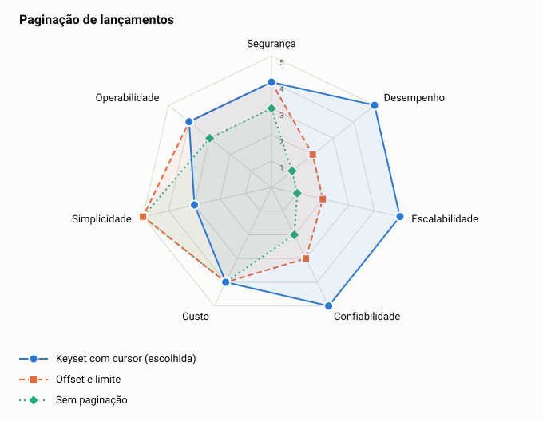

# ADR-0019: Paginação de lançamentos

- **Status:** aceita
- **Data:** 2026-11-06
- **Registro:** escrito depois da implementação, para documentar uma escolha que já estava no código

## Contexto

A listagem de lançamentos de um dia pode ser grande, e novos lançamentos chegam enquanto o cliente percorre as páginas.

## Decisão

Paginar por cursor, ordenando por `id` dentro de comerciante e data, com o índice `ix_ledger_entry_merchant_date`. O limite padrão é 50 e o máximo é 200.

## Opções

<!-- radar:start -->

| Pilar | **Keyset com cursor** | Offset e limite | Sem paginação |
|---|---:|---:|---:|
| Segurança | 4 | 4 | 3 |
| Desempenho | 5 | 2 | 1 |
| Escalabilidade | 5 | 2 | 1 |
| Confiabilidade | 5 | 3 | 2 |
| Custo | 4 | 4 | 4 |
| Simplicidade | 3 | 5 | 5 |
| Operabilidade | 4 | 4 | 3 |
<!-- radar:end -->

## Leitura do radar

Offset é mais simples e permite pular para qualquer página, mas fica mais lento nas páginas finais e repete ou perde itens quando a lista muda. Keyset custa o tempo constante de um índice e não permite pular páginas, o que não é necessário numa API.

## Consequências

**Positivas**

- Tempo de resposta estável em qualquer página
- Lista que muda não duplica nem omite itens já percorridos

**Negativas**

- Não é possível ir direto a uma página numerada
- A ordem é a do `id`, um UUID v7. Ela segue o momento do registro, e não um campo escolhido pelo cliente

## Gatilho de revisão

Rever se os clientes precisarem ordenar por outro campo. A chave do cursor passaria a incluir esse campo.
