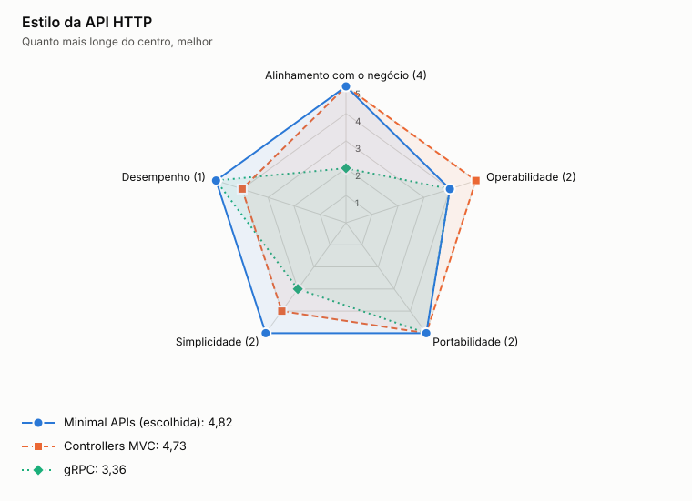

# ADR-0020: Estilo da API HTTP

- **Status:** aceita
- **Data:** 2026-11-06
- **Registro:** escrito depois da implementação, para documentar uma escolha que já estava no código

## Contexto

As APIs têm poucas rotas, consumidas por clientes externos pelo gateway, e o contrato é publicado em OpenAPI.

## Decisão

Usar ASP.NET Core Minimal APIs, com REST e JSON, rotas em `/v1` e erros no formato Problem Details.

## Opções

<!-- radar:start -->

| Critério | Peso | **Minimal APIs** | Controllers MVC | gRPC |
|---|---:|---:|---:|---:|
| Alinhamento com o negócio | 4 | 5 | 5 | 2 |
| Operabilidade | 2 | 4 | 5 | 4 |
| Portabilidade | 2 | 5 | 5 | 5 |
| Simplicidade | 2 | 5 | 4 | 3 |
| Desempenho | 1 | 5 | 4 | 5 |
| **Resultado** | | **4,82** | **4,73** | **3,36** |

As perguntas e a evidência de cada nota estão na [avaliação dos radares](../21-avaliacao-dos-radares.md#adr-0020).
<!-- radar:end -->

## Leitura do radar

Controllers organizam bem APIs grandes, mas acrescentam estrutura para um punhado de rotas. gRPC tem melhor desempenho, mas dificulta o consumo externo e o gateway, e a medição mostrou que a latência não é o gargalo. Minimal APIs mantêm cada rota curta e próxima do caso de uso.

## Consequências

**Positivas**

- Pouco código entre a rota e o caso de uso
- Sem camada de controllers para manter

**Negativas**

- Com muitas rotas, a organização depende de convenção própria
- Parte do ecossistema ainda é pensada primeiro para controllers

## Gatilho de revisão

Rever se o número de rotas crescer muito, ou se surgir comunicação interna de alto volume, caso em que gRPC volta à mesa.
