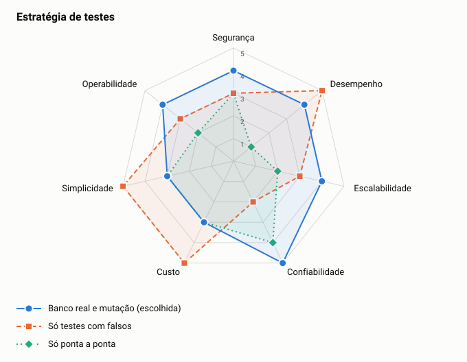

# ADR-0021: Estratégia de testes

- **Status:** aceita
- **Data:** 2026-11-06
- **Registro:** escrito depois da implementação, para documentar uma escolha que já estava no código

## Contexto

O princípio P7 exige prova para cada afirmação de qualidade. Parte das garantias está no SQL, como unicidade, travas e `ON CONFLICT`, e não pode ser provada com falsos em memória.

## Decisão

Testar o domínio com xUnit e falsos, os adaptadores com PostgreSQL real por Testcontainers, o fluxo completo com `smoke.sh`, a carga com k6 e a qualidade dos testes com Stryker.NET. A mutação roda sobre o núcleo e fica fora do CI.

## Opções

<!-- radar:start -->

| Pilar | **Banco real e mutação** | Só testes com falsos | Só ponta a ponta |
|---|---:|---:|---:|
| Segurança | 4 | 3 | 3 |
| Desempenho | 4 | 5 | 1 |
| Escalabilidade | 4 | 3 | 2 |
| Confiabilidade | 5 | 2 | 4 |
| Custo | 3 | 5 | 3 |
| Simplicidade | 3 | 5 | 3 |
| Operabilidade | 4 | 3 | 2 |
<!-- radar:end -->

## Leitura do radar

Testes só com falsos são rápidos, mas não exercitam o SQL. Foi um teste com banco real que achou o defeito de horário fora de UTC, que mandaria eventos válidos para as mensagens mortas. Testes só de ponta a ponta são lentos e não mostram onde está a falha. A combinação custa mais tempo de execução, e Docker para os testes de integração. Esse custo se paga no achado de defeitos reais.

## Consequências

**Positivas**

- As garantias em SQL são testadas no banco real
- A mutação mede se os testes detectam mudanças, e não apenas se passam por uma linha

**Negativas**

- Os testes de integração exigem Docker
- A mutação é lenta, então pode ficar defasada por não rodar a cada mudança
- Os testes não cobrem o Pub/Sub real, e a carga é local

## Gatilho de revisão

Rever se a suíte ficar lenta a ponto de atrapalhar. A mutação pode rodar só sobre o que mudou, ou de forma agendada no CI.
